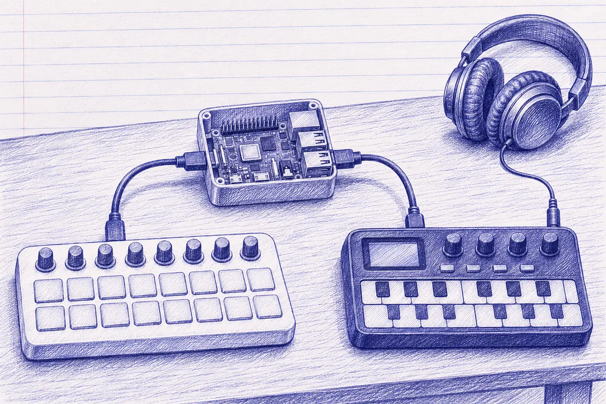

# Preparando um hub MIDI com Raspberry Pi para ligar o BeatStep ao FM-1

Published: 2026-11-14
Author: Gilmar Pupo
Editorial: equipamento
Content type: essay
Canonical: https://www.gpupo.com/equipamento-musical/criando-hub-midi-raspberry-pi-beatstep-fm1/
Tags: Equipamento musical, MIDI, Raspberry Pi, Arturia BeatStep, M-Vave FM-1

---

Depois de [instalar o FMini-1 no meu M-Vave FM-1](/equipamento-musical/transformando-meu-fm1-num-synth-inspirado-no-minimoog/), quis colocar outro aparelho para conversar com ele: o Arturia BeatStep. A ideia era usar os pads, os knobs e uma sequência de notas sem precisar deixar o computador ligado no meio do caminho.

Queria conectar os aparelhos, apertar Play e tocar. Depois veio a vontade de ampliar a mesa, com outros controladores e sintetizadores. Foi assim que comecei a preparar um Raspberry Pi 4 para funcionar como host USB e encaminhar as mensagens MIDI entre eles.

Por enquanto, os testes aconteceram no computador. Já escolhi o software e preparei os pacotes de instalação, mas **a caixa com o Raspberry ainda não está montada nem validada**.

<figure class="editorial-photo">
  
  <figcaption>Ilustração conceitual gerada por IA do conjunto que pretendo montar, com aparelhos estilizados; não é um esquema de ligação nem uma instalação concluída.</figcaption>
</figure>

## Primeiro, descobrir por onde as notas passavam

Minha primeira tentativa foi com um cabo P2 mono. Não resolveu. Na ligação MIDI entre esses aparelhos, o encaixe do plugue não basta: o cabo precisa ser compatível com a pinagem nas duas pontas. Mesmo um P2 estéreo não resolve essa dúvida sozinho.

Para tirar o cabo dessa investigação, conectei os dois por USB ao computador. Cada aparelho apareceu como um dispositivo MIDI separado. O computador podia receber as mensagens de um e encaminhá-las ao outro, desde que criássemos essa ligação no sistema.

Comecei pelo destino. Com a ajuda do Codex, enviei pelo terminal uma frase curta em Dó maior para o FM-1, no canal MIDI 1. O aparelho tocou. Repetimos a mesma frase no canal 2 e houve silêncio.

Isso deu uma referência para continuar: naquela configuração, a frase tocava no canal 1. O silêncio no canal 2 não bastava para afirmar que nenhuma mensagem chegava ao aparelho; o que eu tinha confirmado era a ausência de som naquele teste.

Depois monitoramos o BeatStep. Ele enviava mensagens de início e fim de nota, Note On e Note Off, no canal 1. No trecho observado, repetia a nota MIDI 60 com velocidade 64. Também aparecia MIDI Clock, o relógio usado para sincronizar o andamento.

Com os dois disponíveis no Linux, criamos uma conexão entre suas portas pelo ALSA, a infraestrutura de áudio e MIDI do sistema:

```text
BeatStep → USB → computador → USB → FM-1 → áudio
```

A rota foi criada e conferida no sistema. A confirmação sonora que registrei, porém, foi a da frase enviada diretamente ao FM-1. Ouvir a ponte inteira respondendo ao BeatStep ainda ficou na lista de verificações.

## O Raspberry vai encaminhar MIDI; o som continua no FM-1

Essa diferença me ajudou a entender a caixa que eu queria montar. O Raspberry receberia notas e controles e os enviaria ao sintetizador. O FM-1 continuaria produzindo o som, com o fone ou a caixa ligados nele.

Para essa função de encaminhamento MIDI, não preciso acrescentar uma interface de áudio ao Pi. Se depois quiser juntar o áudio de vários instrumentos ou gravá-los, aí entram outras escolhas: mixer, interface e conexões de áudio.

Ao imaginar mais aparelhos, minha primeira ideia foi reservar um canal para cada um. Foi quando precisei separar duas coisas que estava misturando: **porta e canal MIDI**.

No MIDI 1.0, as mensagens de canal podem usar [16 canais][midi]. Como dois sintetizadores USB aparecem em portas separadas, os dois podem receber no canal 1. O host precisa enviar para a porta certa. Também posso configurar uma rota que receba no canal 2 e entregue no canal 1.

Isso abre possibilidades que quero experimentar: a mesma execução tocando dois timbres, ou os controles seguindo para um instrumento enquanto a sequência vai para outro, dentro do que o controlador permitir. Escolher canais não cria sequências independentes a mais no BeatStep.

Clock e transporte pedem outra decisão. MIDI Clock, Start e Stop são [mensagens de sistema, sem canal][midi]. Quero escolher quem fornece o relógio e quais instrumentos devem segui-lo. O BeatStep é meu candidato inicial, mas ainda preciso verificar o sincronismo com o FMini-1.

## Encontrei um projeto que já fazia boa parte disso

Cheguei a considerar escrever um serviço para cuidar das conexões. Antes, procurei o que já existia e encontrei o [RaspiMIDIHub][hub]. O projeto oferece roteamento entre dispositivos, filtros e mapeamentos por conexão e uma interface web que pode ser acessada pelo celular. Também prevê recuperação das conexões e configurações salvas.

Criei um fork para acompanhar o código e preparar minha instalação. Em vez de começar o roteador do zero, passei a trabalhar na escolha da revisão, na geração dos pacotes e no que precisaria conferir com meus aparelhos.

Dois detalhes apareceram nessa leitura. O README falava em conexão automática entre todos os dispositivos, enquanto o código e o manual da revisão analisada indicavam novos pares desconectados por padrão. Para minha montagem, quero definir as rotas explicitamente.

Também vi que os scripts de instalação e atualização ainda apontavam para o repositório original. Clonar meu fork não faria o instalador usar automaticamente aquele código. Para controlar a versão preparada, gerei os pacotes a partir do checkout local.

Nessa preparação, a suíte terminou com **937 testes passando e um desmarcado**. O `make all` produziu os pacotes RaspiMIDIHub 6.0.0 e `rosetup` 1.0.2, este último opcional, para preparar a operação com o sistema de arquivos somente leitura. Conferimos o conteúdo essencial dos pacotes e guardamos seus hashes.

Foi um avanço na preparação do software. Alimentação USB, estabilidade e recuperação com os instrumentos conectados continuam dependendo da montagem física.

## O que quero conferir quando a caixa estiver montada

Vou usar um cartão dedicado no Raspberry Pi 4, porque a instalação altera serviços e configurações do sistema. Também preciso dimensionar a alimentação dos periféricos; conforme o conjunto crescer, pretendo usar um hub USB com fonte própria.

A primeira tentativa será pequena: ligar o Pi com BeatStep e FM-1 conectados e ouvir as notas no canal 1, sem abrir o terminal. Depois, retirar e recolocar os cabos, reiniciar e conferir se a rota volta sozinha.

Quando acrescentar outro FM-1, quero observar como cada unidade se identifica por USB. Se não houver seriais distintos, vou precisar usar as portas físicas do hub como parte da organização. Trocar a ordem de conexão não pode mandar as notas para o instrumento errado.

Também ficaram alguns testes menos vistosos: desconectar o controlador durante uma nota longa, interromper uma execução com sustain e usar o comando *panic* para tentar silenciar notas que ficarem presas. Quero saber como o conjunto reage antes de depender dele para tocar.

Por enquanto, o computador ajudou a separar as dúvidas: o FM-1 respondeu às notas, o BeatStep enviou mensagens e a rota apareceu no Linux. O que espero da próxima etapa é conseguir ligar essa pequena caixa, apertar Play e deixar o computador fora da mesa.

[midi]: https://midi.org/summary-of-midi-1-0-messages "Resumo oficial das mensagens MIDI 1.0"
[hub]: https://github.com/wamdam/raspimidihub "RaspiMIDIHub, projeto original"
