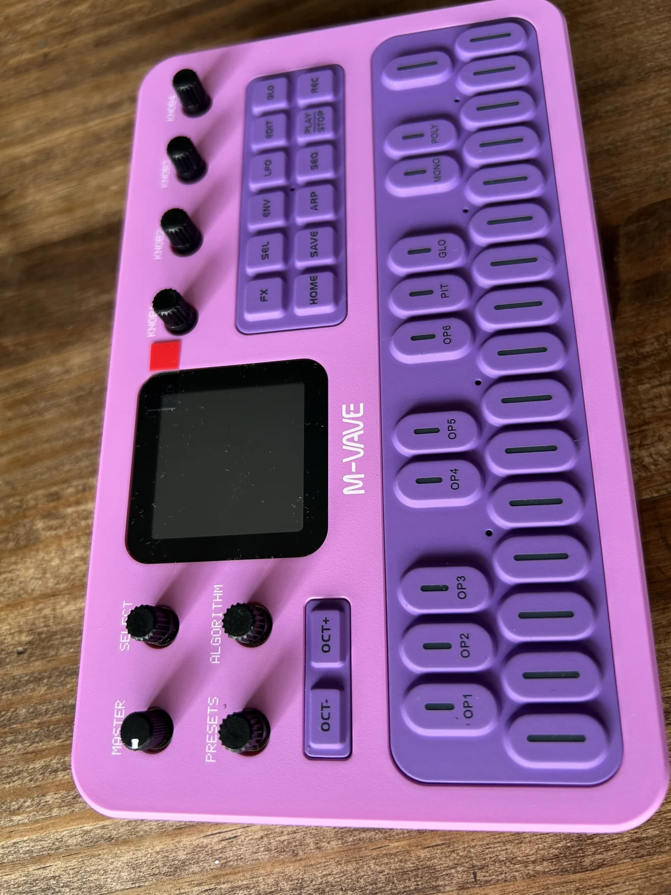
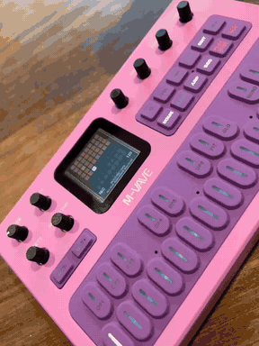

# Transformando meu FM-1 num synth inspirado no Minimoog

Published: 2026-11-11
Author: Gilmar Pupo
Editorial: equipamento
Content type: essay
Canonical: https://www.gpupo.com/equipamento-musical/transformando-meu-fm1-num-synth-inspirado-no-minimoog/
Tags: Equipamento musical, Sintetizador, M-Vave FM-1, FMini-1, MIDI

---

<figure class="editorial-photo">
  
  <figcaption>Meu M-Vave FM-1.</figcaption>
</figure>

Quando meu M-Vave FM-1 chegou, eu já tinha uma lista de firmwares para
experimentar. Queria descobrir quantos instrumentos diferentes cabiam naquele
mesmo aparelho, aproveitando os projetos que a comunidade desenvolve para ele.

Depois de pesquisar e experimentar algumas opções no emulador, escolhi o
**FMini-1 v2.5.0**, de Guilherme Ruppert. O [projeto se apresenta][fmini] como
uma emulação do Minimoog Model D para o FM-1, com efeitos, arpejador e
sequenciador. Foi essa proposta que me atraiu: explorar outra forma de síntese
usando o hardware que eu já tinha.

Até conseguir tocar, porém, passei por uma investigação sobre USB, permissões
do navegador e nomes de dispositivos MIDI. Fiz o processo com a ajuda do Codex,
usando uma máquina Linux para consultar o aparelho, registrar os resultados e,
no fim, enviar o firmware pelo terminal.

## Uma lembrança do som de fábrica

Comecei conferindo o funcionamento original. O aparelho produzia som, mas não
mostrava a versão do firmware ao ligar, e eu não encontrei número de
identificação na etiqueta. Pelo USB, o Linux o reconheceu como dispositivo de
áudio e MIDI. Uma consulta de identidade via MIDI retornou `FM-1_015`,
indicando a versão 15.

Antes da troca, gravei quinze segundos tocando o preset **099 BLOCK**, capturados
diretamente pelo USB, em estéreo, a 44,1 kHz e 24 bits. Ouvi o arquivo e confirmei
que era o que eu havia tocado. Guardei o WAV bruto e os dados da gravação.

Essa era uma referência sonora do aparelho original. Não fiz um backup integral
da memória nem uma exportação dos presets; portanto, a gravação não permitiria
restaurar o estado anterior.

## O instalador encontrava o aparelho e depois o perdia

Minha primeira tentativa foi pelo navegador, no Firmware Hub. O site reclamava
que o acesso MIDI com SysEx não estava permitido, mesmo depois de eu conceder
a permissão. Era por esse tipo de mensagem MIDI que o instalador precisava
conversar com o aparelho para transferir o firmware.

No Linux, confirmamos que a porta MIDI existia e que a permissão estava
registrada no perfil principal do Chromium. Ainda assim, a página recusava o
acesso. O navegador instalado era a versão Snap, mas não chegamos a demonstrar
que isso causava o problema.

Tentei também no Windows. Ali o instalador encontrava o FM-1 no primeiro passo,
mas, na hora de enviar o firmware, dizia que não encontrava mais o dispositivo.
A troca de computador não resolveu, e a causa dessa falha ficou sem confirmação.

Voltamos ao Linux para tentar a ferramenta de instalação por linha de comando
do [Felucca][felucca], projeto em que o FMini-1 se baseia. Assim, a comunicação
MIDI podia acontecer sem depender da autorização do navegador.

Baixamos o arquivo `FMini-1-v2.5.0.fwsc` da [release oficial][release] e
conferimos seu SHA-256 com o digest publicado no GitHub. A ferramenta aceitou o
pacote sem precisar forçar a validação. A release declara suporte ao chip de
memória UC25HQ80, usado em unidades mais novas, mas o chip específico do meu
aparelho não foi identificado.

## Ele continuava ali, com outro nome

Com o FM-1 conectado diretamente ao computador, a consulta pelo terminal
encontrou `FM-1_015`. Iniciamos a atualização: o aparelho respondeu, verificou
o pacote e entrou no modo de instalação.

Nesse momento, seu nome MIDI mudou para **`FMini-1 Update`**.

O dispositivo continuava presente no Linux. Só que a ferramenta procurava
portas com determinados nomes, e seu filtro não incluía `FMini-1`. Depois de
esperar, encerrava dizendo que não havia encontrado o *loader*, o pequeno
programa responsável por receber e gravar a atualização.

Acrescentamos `fmini-1` ao filtro de descoberta das portas MIDI, mantendo as
validações do pacote e a lógica de transferência da ferramenta original. Com
essa adaptação, o instalador encontrou o aparelho já em modo de atualização,
identificado como `ota-FM-1_900`, e retomou o envio.

A transferência chegou ao fim. O FM-1 reiniciou e respondeu com a identidade
esperada, **`FM-1_900`**. Fizemos outra consulta para confirmar o retorno. Testei
o aparelho e finalmente pude dizer: funcionando!

<figure class="editorial-photo">
  
  <figcaption>Meu FM-1 em funcionamento. GIF convertido do vídeo original, sem áudio.</figcaption>
</figure>

A mudança de nome explica a falha que observamos no terminal. Não verificamos
se ela também tinha relação com o problema no Windows. A recusa de SysEx no
Chromium aconteceu antes dessa etapa e permaneceu como um problema separado.

O detalhe que mais me marcou foi descobrir que “dispositivo não encontrado”
podia significar que ele estava conectado, apenas com um nome que a ferramenta
não esperava.

Consegui deixar o FMini-1 v2.5.0 rodando no meu FM-1. Essa primeira confirmação
foi de funcionamento geral; ainda ficaram para outra sessão a avaliação dos
controles, dos timbres e da persistência dos presets depois de desligar.

Agora começa a parte que motivou todo esse trabalho: explorar os presets,
mexer nos osciladores e no filtro e criar meus próprios timbres no FMini-1.

Continuei a experiência em [Preparando um hub MIDI com Raspberry Pi para ligar o BeatStep ao FM-1](/equipamento-musical/criando-hub-midi-raspberry-pi-beatstep-fm1/).

[fmini]: https://github.com/ruppert/fmini-1/tree/v2.5.0 "FMini-1 de Guilherme Ruppert, versão 2.5.0"
[felucca]: https://github.com/hugelton/Felucca "Projeto Felucca"
[release]: https://github.com/ruppert/fmini-1/releases/tag/v2.5.0 "Release oficial do FMini-1 v2.5.0"
