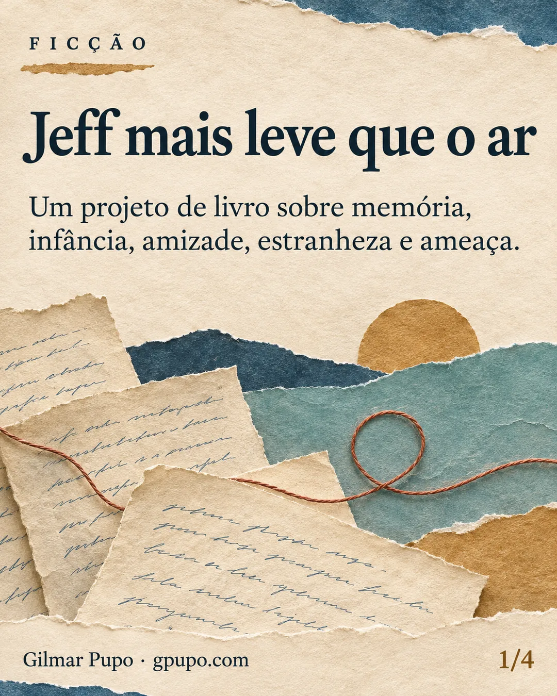
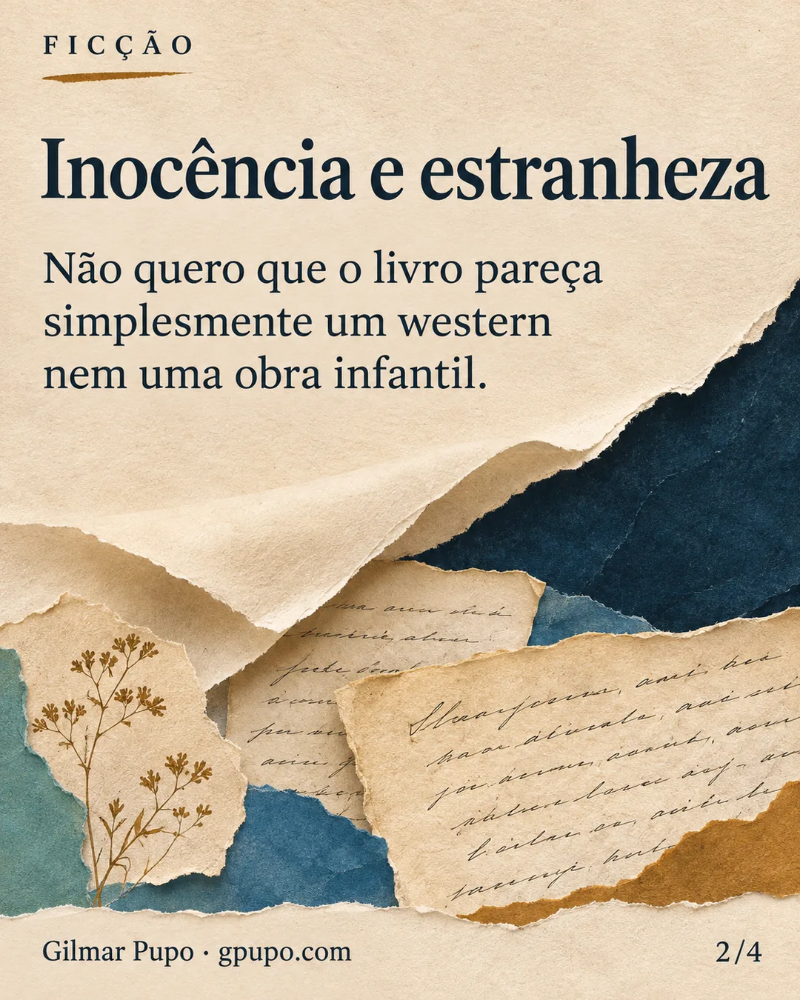
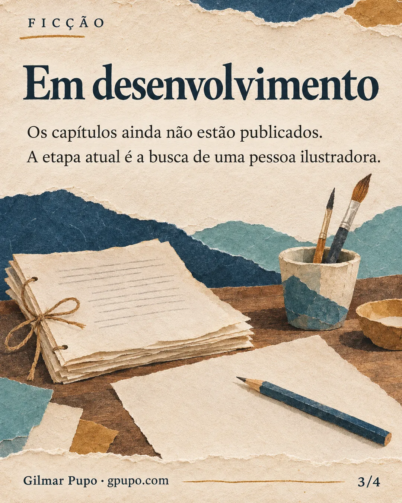
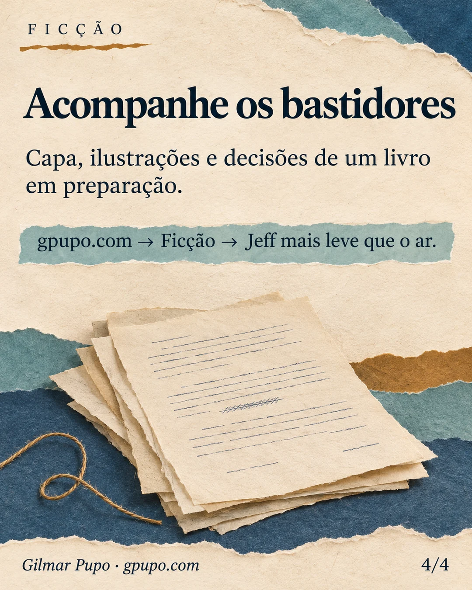

# Jeff mais leve que o ar

Published: 2026-09-29
Author: Gilmar Pupo
Editorial: ficcao
Content type: book
Canonical: https://www.gpupo.com/ficcao/jeff-mais-leve-que-o-ar/

---

Escrevi *Jeff mais leve que o ar* há muito tempo e decidi retomá-lo como um
projeto de livro. Esta página começa antes da publicação dos capítulos: por
enquanto, ela registra o desenvolvimento da obra e reúne seus bastidores.

## Sobre o livro

*Jeff mais leve que o ar* mistura memória, infância, humor estranho, solidão,
fantasia, western, violência e momentos quase sobrenaturais.

Não quero que o livro pareça simplesmente um western nem uma obra infantil. O
contraste entre inocência, estranheza e ameaça faz parte da história e também
da identidade visual que estou procurando para ela.

## Estado do projeto

A publicação dos capítulos foi adiada enquanto cuido da capa e das ilustrações
internas. A etapa atual é encontrar e contratar uma pessoa ilustradora para
desenvolver uma linguagem visual própria para o livro.

Quando houver uma edição preparada para leitura, esta página passará a reunir
o acesso à obra e aos formatos disponíveis. Até lá, ela funciona como o ponto
de entrada para acompanhar as decisões do projeto.

<section class="fiction-book-related" aria-labelledby="fiction-book-related-title">
  <h2 id="fiction-book-related-title" class="no_anchor">Bastidores do projeto</h2>
  
Textos sobre as decisões e o desenvolvimento do livro.

  
  <ul class="fiction-book-related-list">
    
    <li>
      <article>
        

          
          <a href="/escrita/">Escrita</a>
          
          · <time datetime="2026-09-29T00:00:00-03:00">29/09/2026</time>
          
        

        <h3 class="no_anchor"><a href="/ficcao/jeff-mais-leve-que-o-ar/briefing-de-ilustracao/">O briefing de ilustração de Jeff mais leve que o ar</a></h3>
        
        
Os estudos gerados no ChatGPT 5.6 SOL não fazem parte do livro: são um ponto de partida para contratar um artista e buscar uma identidade visual própria.

        
      </article>
    </li>
    
    <li>
      <article>
        

          
          <a href="/escrita/">Escrita</a>
          
          · <time datetime="2026-09-29T00:00:00-03:00">29/09/2026</time>
          
        

        <h3 class="no_anchor"><a href="/escrita/como-voce-publicaria-um-livro-sem-entregar-a-experiencia-para-outra-pessoa/">Como você publicaria um livro sem entregar a experiência para outra pessoa?</a></h3>
        
        
Ao retomar Jeff mais leve que o ar, tento decidir o que significa publicar um livro sem entregar a outra pessoa toda a experiência da obra.

        
      </article>
    </li>
    
  </ul>
  
</section>

<section class="editorial-carousel" data-editorial-carousel aria-roledescription="carrossel" aria-labelledby="jeff-mais-leve-que-o-ar-title">
  <h2 id="jeff-mais-leve-que-o-ar-title">Jeff mais leve que o ar, em quatro quadros</h2>
  
Apresentação de um livro em desenvolvimento. Colagens promocionais geradas com IA; não são capa nem ilustrações internas da obra. Os capítulos ainda não estão publicados.

  
Deslize para acompanhar os quadros. Com o carrossel em foco, use as setas do teclado.

  

    
    <figure class="editorial-carousel__slide" role="group" aria-roledescription="quadro" aria-label="1 de 4">
      
      <figcaption>Quadro 1 de 4 · Jeff mais leve que o ar</figcaption>
    </figure>
    
    <figure class="editorial-carousel__slide" role="group" aria-roledescription="quadro" aria-label="2 de 4">
      
      <figcaption>Quadro 2 de 4 · Inocência e estranheza</figcaption>
    </figure>
    
    <figure class="editorial-carousel__slide" role="group" aria-roledescription="quadro" aria-label="3 de 4">
      
      <figcaption>Quadro 3 de 4 · Em desenvolvimento</figcaption>
    </figure>
    
    <figure class="editorial-carousel__slide" role="group" aria-roledescription="quadro" aria-label="4 de 4">
      
      <figcaption>Quadro 4 de 4 · Acompanhe os bastidores</figcaption>
    </figure>
    
  

  

    <button class="btn" type="button" data-carousel-previous aria-controls="jeff-mais-leve-que-o-ar-slides" aria-label="Quadro anterior" disabled>← Anterior</button>
    1 de 4
    <button class="btn" type="button" data-carousel-next aria-controls="jeff-mais-leve-que-o-ar-slides" aria-label="Próximo quadro">Próximo →</button>
  

  

    
Ler o texto dos quadros

    <ol>
      <li>
FICÇÃO 
 
Jeff mais leve que o ar 
 
Um projeto de livro sobre memória, infância, amizade, estranheza e ameaça. 
 
Gilmar Pupo · gpupo.com 
1/4
</li>
      <li>
FICÇÃO 
 
Inocência e estranheza 
 
Não quero que o livro pareça simplesmente um western nem uma obra infantil. 
 
Gilmar Pupo · gpupo.com 
2/4
</li>
      <li>
FICÇÃO 
 
Em desenvolvimento 
 
Os capítulos ainda não estão publicados. 
A etapa atual é a busca de uma pessoa ilustradora. 
 
Gilmar Pupo · gpupo.com 
3/4
</li>
      <li>
FICÇÃO 
 
Acompanhe os bastidores 
 
Capa, ilustrações e decisões de um livro em preparação. 
 
gpupo.com → Ficção → Jeff mais leve que o ar. 
 
Gilmar Pupo · gpupo.com 
4/4
</li>
    </ol>
  

</section>

