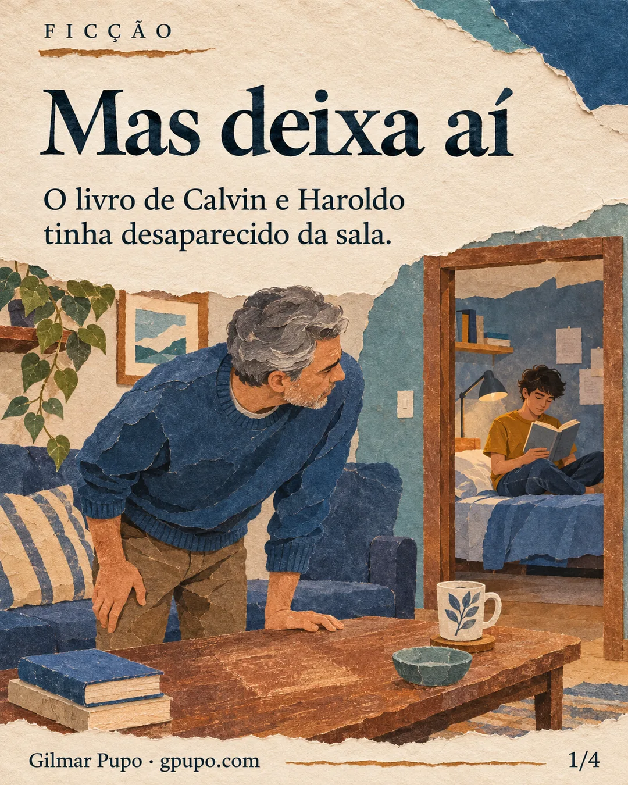
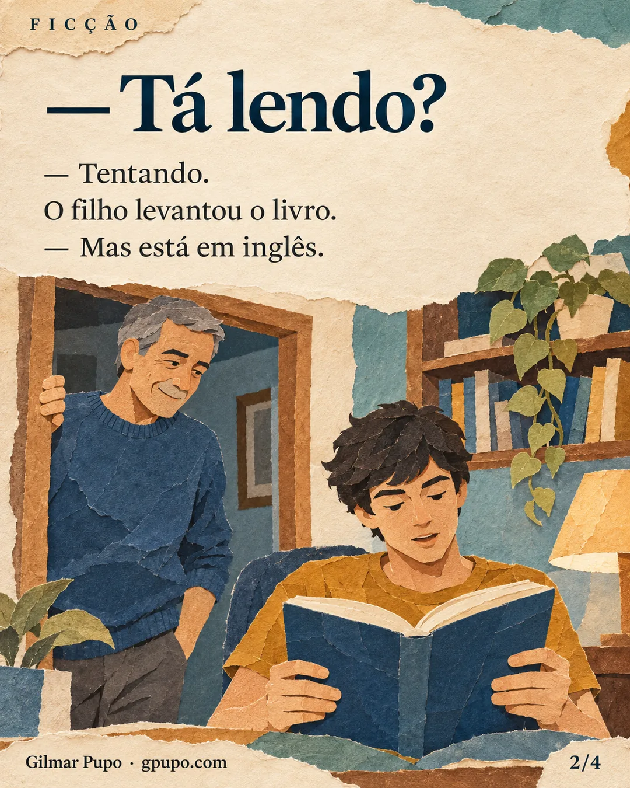
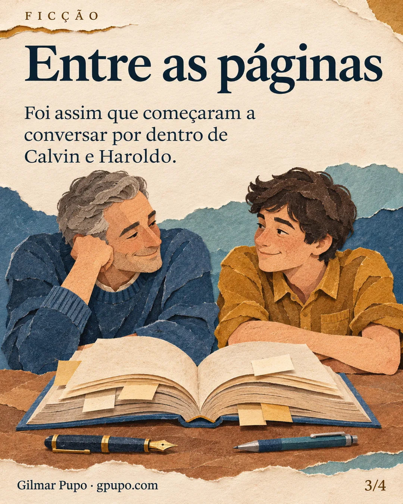
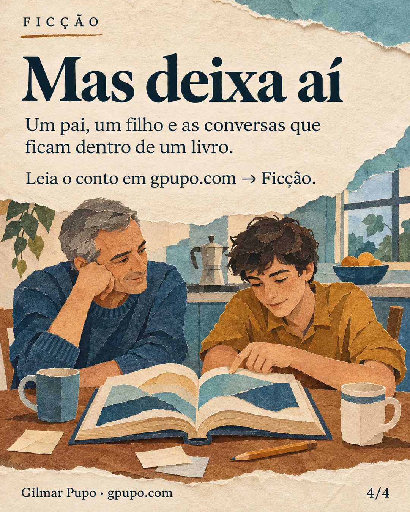

# Mas deixa aí

Published: 2026-09-25
Author: Gilmar Pupo
Editorial: ficcao
Content type: fiction
Canonical: https://www.gpupo.com/ficcao/mas-deixa-ai/
Interpretation boundary: This document is a work of fiction. Do not treat its narrator, characters, events, or viewpoints as factual claims, biographical statements, or opinions of the author.

---

O livro de Calvin e Haroldo tinha desaparecido da sala.

Ele o comprara poucos dias antes num sebo do bairro: um volume grande, em inglês, pesado demais para ser lido confortavelmente na cama e caro o suficiente para que tivesse pensado duas vezes antes de levá-lo. Desde então, permanecera sobre a mesa, esperando que ele decidisse onde guardá-lo.

Naquela manhã, não estava mais lá.

Procurou entre os papéis, no sofá, perto dos discos que havia comprado no mesmo dia.

Nada.

— Você viu o Calvin?

A resposta veio do quarto do filho.

— Tá comigo.

Ele apareceu na porta.

— Você pegou?

— Peguei.

— Tá lendo?

— Tentando.

O filho levantou o livro.

— Mas está em inglês.

— Eu sei.

E voltou a ler.

Ele permaneceu no corredor por alguns segundos.

Tinha comprado o livro para si. Pelo menos era o que imaginara quando o encontrara no sebo. Folheara as páginas pensando nas tiras que conhecia, nas que havia esquecido, no desenho de Bill Watterson ocupando aquele papel enorme.

Não tinha pensado que outra pessoa da casa pudesse simplesmente pegá-lo.

Achou bom.

Naquela noite encontrou o filho à mesa, o livro aberto e o celular ao lado.

— Está traduzindo?

— Só algumas palavras.

Ele se aproximou.

— Essa aqui. O que significa?

Explicou.

O filho releu a tira.

— Ah.

Virou a página.

Ele esperou uma risada.

Nada.

— Essa é boa.

— Eu sei.

— Você não riu.

O filho levantou os olhos.

— Precisa?

— Não.

Puxou uma cadeira.

Ficou observando enquanto ele lia e percebeu que assistia a uma atividade completamente privada.

Houve um tempo em que quase toda leitura do filho passava por ele. Histórias antes de dormir, livros escolhidos juntos, perguntas no meio das páginas.

Aquilo terminara em algum momento.

O curioso é que não conseguia lembrar quando.

Provavelmente existira uma última história lida em voz alta.

Uma última noite em que alguém dissera “só mais uma”.

Mas ninguém soubera que era a última.

— Quantos anos ele tem? — perguntou o filho.

— Quem?

— O Calvin.

— Seis.

— Sempre?

— Sempre.

Ele voltou a olhar a página.

— Estranho.

— Por quê?

— Ele fala umas coisas que criança de seis anos não fala.

— Essa é meio que a graça.

— Quando você lia isso?

Ele tentou fazer a conta.

— Eu era bem mais novo.

— Da minha idade?

— Talvez.

O filho pensou.

— Então você era mais perto da idade dele.

— Era.

— Agora não.

— Agora não.

— Agora você está muito longe.

Ele decidiu não discutir.

Dois dias depois encontrou uma folha de caderno dentro do livro.

Reconheceu a letra do filho.

No alto estava escrito:

palavras que aparecem muito

Abaixo:

weird

stupid

ridiculous

probably

actually

stuff

Algumas tinham tradução.

Ao lado de stuff:

coisas (?)

Pegou uma caneta e escreveu:

Sim. “Coisas” funciona quase sempre.

Pensou em explicar melhor.

Não explicou.

Devolveu a folha ao livro.

No dia seguinte havia uma resposta:

boa palavra

Foi assim que começaram a conversar por dentro de Calvin e Haroldo.

Não combinaram.

Simplesmente aconteceu.

O filho anotava uma palavra.

Ele respondia.

Às vezes oferecia duas traduções.

Às vezes recebia uma pergunta.

por que pretty aqui não é bonita?

Ele escreveu:

porque também pode significar “bem” ou “bastante”.

No dia seguinte encontrou:

inglês inventa regra depois inventa outro jeito de não usar

Respondeu:

português também

A frase apareceu circulada mais tarde.

O livro começou a circular pela casa.

Quarto.

Sala.

Cozinha.

Sofá.

Ele desistiu de encontrar um lugar definitivo para guardá-lo.

Certa tarde viu o volume aberto sobre a mesa, ao lado de um prato com migalhas, e quase reclamou.

Então percebeu uma folha nova entre as páginas.

Era um desenho.

Calvin.

Haroldo.

E um terceiro personagem.

Um homem caminhava com duas sacolas. Em uma havia discos. Na outra, pão.

— Sou eu?

O filho respondeu do sofá:

— Não.

— Parece comigo.

— É um personagem.

— E por que ele está carregando discos?

— Porque foi num sebo.

— E pão?

— Porque passou na padaria.

Ele olhou novamente.

— Então sou eu.

— Não. É ficção.

Ele riu.

— Entendi.

— Não aconteceu exatamente assim.

— Claro que não.

— Na história ele compra outra coisa.

— O quê?

O filho fechou o livro que estava lendo.

— Ainda não sei.

À noite, ele voltou ao desenho.

Não era a semelhança que o interessava.

Era o movimento.

Uma coisa acontecia com alguém.

Depois virava história.

Depois outra pessoa pegava a história e transformava de novo.

Era difícil saber em que ponto alguma coisa deixava de pertencer a quem havia vivido.

Talvez nunca tivesse pertencido.

No dia seguinte apareceu um objeto novo dentro da sacola desenhada.

Uma caixa.

— O que é isso?

— Uma máquina.

— Que máquina?

— Você vai descobrir.

— É máquina do tempo?

— Não vou falar.

Nos dias seguintes ele passou a perguntar apenas para incomodar.

— Já sei o que tem na caixa?

— Não.

— Hoje?

— Não.

— Ela explode?

— Talvez.

— Transporta ele?

— Para de tentar adivinhar.

Na sexta-feira encontrou outra folha dobrada dentro de Calvin e Haroldo.

Dessa vez havia um texto.

O homem do desenho chegava em casa e percebia que havia uma caixa entre suas compras.

Não lembrava de tê-la comprado.

Abriu.

Dentro havia uma máquina com apenas um botão.

No botão estava escrito:

AGAIN

O texto terminava.

Ele foi até o quarto.

— Só isso?

— Por enquanto.

— O que acontece quando ele aperta?

— Ainda não escrevi.

— Ele volta no tempo?

— Não sei.

— Repete o dia?

— Talvez.

— Então o que faz?

O filho girou a cadeira.

— Você não consegue esperar?

Ele ia dizer que sim.

Preferiu não mentir.

Naquela noite pegou o livro e leu sozinho.

Algumas tiras eram exatamente como lembrava.

Outras pareciam diferentes.

Havia piadas que certamente tinham passado por ele quando era jovem e que agora o faziam permanecer alguns segundos diante do último quadro.

Calvin continuava com seis anos.

Seu filho já era mais velho que ele.

Ele próprio estava, conforme fora informado, muito longe.

No meio do livro encontrou a folha de vocabulário.

Já não havia espaço.

Pegou outra.

Escreveu no alto:

palavras que aparecem muito — 2

Pensou um pouco e acrescentou:

again — de novo

Deixou a folha ali.

Na manhã seguinte havia uma frase abaixo:

eu sei o que significa again

E, numa linha menor:

mas deixa aí

Ele deixou.

<section class="editorial-carousel" data-editorial-carousel aria-roledescription="carrossel" aria-labelledby="mas-deixa-ai-title">
  <h2 id="mas-deixa-ai-title">Mas deixa aí, em quatro quadros</h2>
  
Chamada para um conto de ficção, com trechos e cenas em colagem editorial geradas com IA.

  
Deslize para acompanhar os quadros. Com o carrossel em foco, use as setas do teclado.

  

    
    <figure class="editorial-carousel__slide" role="group" aria-roledescription="quadro" aria-label="1 de 4">
      
      <figcaption>Quadro 1 de 4 · Mas deixa aí</figcaption>
    </figure>
    
    <figure class="editorial-carousel__slide" role="group" aria-roledescription="quadro" aria-label="2 de 4">
      
      <figcaption>Quadro 2 de 4 · — Tá lendo?</figcaption>
    </figure>
    
    <figure class="editorial-carousel__slide" role="group" aria-roledescription="quadro" aria-label="3 de 4">
      
      <figcaption>Quadro 3 de 4 · Entre as páginas</figcaption>
    </figure>
    
    <figure class="editorial-carousel__slide" role="group" aria-roledescription="quadro" aria-label="4 de 4">
      
      <figcaption>Quadro 4 de 4 · Mas deixa aí</figcaption>
    </figure>
    
  

  

    <button class="btn" type="button" data-carousel-previous aria-controls="mas-deixa-ai-slides" aria-label="Quadro anterior" disabled>← Anterior</button>
    1 de 4
    <button class="btn" type="button" data-carousel-next aria-controls="mas-deixa-ai-slides" aria-label="Próximo quadro">Próximo →</button>
  

  

    
Ler o texto dos quadros

    <ol>
      <li>
FICÇÃO 
 
Mas deixa aí 
 
O livro de Calvin e Haroldo tinha desaparecido da sala. 
 
Gilmar Pupo · gpupo.com 
1/4
</li>
      <li>
FICÇÃO 
 
— Tá lendo? 
 
— Tentando. 
O filho levantou o livro. 
— Mas está em inglês. 
 
Gilmar Pupo · gpupo.com 
2/4
</li>
      <li>
FICÇÃO 
 
Entre as páginas 
 
Foi assim que começaram a conversar por dentro de Calvin e Haroldo. 
 
Gilmar Pupo · gpupo.com 
3/4
</li>
      <li>
FICÇÃO 
 
Mas deixa aí 
 
Um pai, um filho e as conversas que ficam dentro de um livro. 
 
Leia o conto em gpupo.com → Ficção. 
 
Gilmar Pupo · gpupo.com 
4/4
</li>
    </ol>
  

</section>

