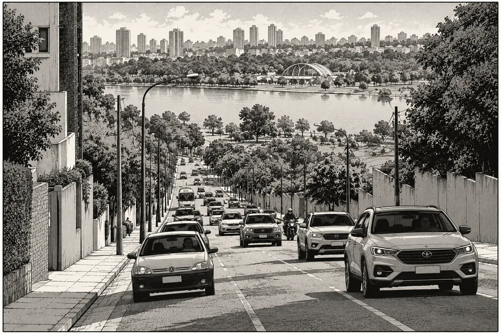
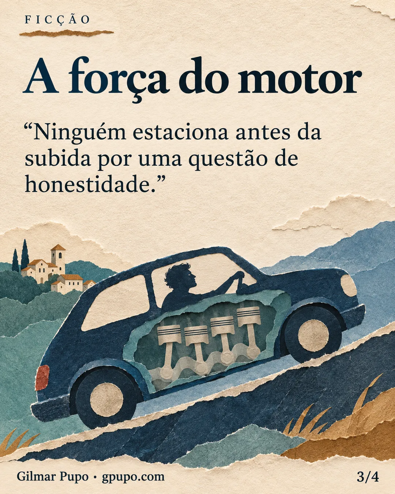

# Musculatura emprestada

Published: 2026-09-26
Author: Gilmar Pupo
Editorial: ficcao
Content type: fiction
Canonical: https://www.gpupo.com/ficcao/musculatura-emprestada/
Interpretation boundary: This document is a work of fiction. Do not treat its narrator, characters, events, or viewpoints as factual claims, biographical statements, or opinions of the author.

---

A rua sobe ao lado do Parque Barigui.

Não é uma subida particularmente longa, mas é suficiente para exigir alguma coisa de quem passa por ali a pé. As pernas percebem. A respiração percebe. Depois de certa idade, o joelho também percebe.

<figure class="editorial-photo">
  
  <figcaption>Ilustração criada com o ChatGPT para este conto.</figcaption>
</figure>

Os carros não.

Talvez seja por isso que tanta gente acelere naquele trecho.

Fico às vezes parado perto da calçada observando. O sinal abre lá embaixo e, durante alguns segundos, a rua inteira parece participar de uma pequena competição que ninguém combinou.

Motores aumentam de rotação.

Automáticos reduzem uma marcha.

Escapamentos engrossam a voz.

Carros pequenos se esforçam. Carros grandes mal percebem a inclinação.

E todos sobem.

Há pessoas fortes dirigindo carros fracos.

Pessoas frágeis dirigindo carros potentes.

Gente que provavelmente não conseguiria correr cem metros naquela inclinação sobe a sessenta quilômetros por hora enquanto conversa ao telefone pelo viva-voz.

Um homem magro passa num utilitário enorme.

Uma mulher pequena dirige um carro que parece capaz de puxar uma casa.

Um rapaz com braços de academia acelera um hatch antigo que demora um pouco mais para responder.

No alto da rua, porém, todos chegam aproximadamente iguais.

A máquina corrige as diferenças.

Ninguém considera isso trapaça.

Ninguém estaciona antes da subida por uma questão de honestidade.

Ninguém diz:

— Daqui para a frente eu prefiro usar apenas minhas capacidades naturais.

Ao contrário.

Se o carro perde velocidade, o motorista pisa mais fundo.

É justamente para isso que existe o motor.

Penso nisso enquanto outro carro passa por mim, ganhando velocidade no meio da subida.

Talvez o motorista tenha acabado de sair de uma reunião.

Talvez, meia hora antes, estivesse dizendo que alguém não deveria ter usado inteligência artificial para escrever um relatório.

Não porque o relatório estivesse errado.

Não porque houvesse fraude.

Não porque alguém tivesse apresentado como conhecimento próprio aquilo que não possuía.

Apenas porque havia uma máquina no processo.

“Assim é fácil”, talvez tenha dito.

Agora ele pisa no acelerador.

O motor injeta combustível.

A combustão empurra pistões.

Os pistões movimentam o virabrequim.

Uma sequência de engrenagens multiplica aquilo que seu corpo jamais conseguiria produzir.

E o carro sobe.

Assim é fácil.

Penso em dizer isso em voz alta, mas não haveria para quem.

Outro carro já vem atrás.

Depois outro.

E outro.

O interessante não é que usamos máquinas para superar nossos limites.

Fazemos isso há tanto tempo que quase não percebemos mais.

O interessante é a velocidade com que algumas máquinas deixam de parecer máquinas.

Óculos não são trapaça para quem enxerga mal.

Calculadoras não ofendem o contador.

Elevadores não diminuem o mérito de quem trabalha no décimo sexto andar.

Um escritor não precisa derrubar uma árvore para merecer escrever num caderno.

Há tecnologias que, depois de algum tempo, desaparecem.

Continuam ali.

Apenas deixam de entrar na conta moral.

Talvez seja isso que chamamos de natural.

Aquilo que já esquecemos que foi inventado.

O sinal fecha novamente.

Os carros se acumulam lá embaixo.

Por alguns segundos, silêncio.

Então o verde aparece.

Um ronco.

Dois.

Cinco.

A pequena manada mecânica começa outra vez a subir.

Alguns motores fazem esforço.

Outros parecem se divertir.

Observo aquela musculatura emprestada avançando pela rua.

Não sei onde termina a pessoa e começa a máquina.

Talvez essa pergunta nunca tenha feito muito sentido.

O primeiro carro chega ao alto.

O motorista não comemora.

Nem deveria.

Ele apenas continua seu caminho.

Como se tivesse subido sozinho.

<section class="editorial-carousel" data-editorial-carousel aria-roledescription="carrossel" aria-labelledby="musculatura-emprestada-title">
  <h2 id="musculatura-emprestada-title">Musculatura emprestada, em quatro quadros</h2>
  
Chamada para um conto de ficção, com trechos e cenas em colagem editorial geradas com IA.

  
Deslize para acompanhar os quadros. Com o carrossel em foco, use as setas do teclado.

  

    
    <figure class="editorial-carousel__slide" role="group" aria-roledescription="quadro" aria-label="1 de 4">
      
      <figcaption>Quadro 1 de 4 · Musculatura emprestada</figcaption>
    </figure>
    
    <figure class="editorial-carousel__slide" role="group" aria-roledescription="quadro" aria-label="2 de 4">
      
      <figcaption>Quadro 2 de 4 · Todos sobem</figcaption>
    </figure>
    
    <figure class="editorial-carousel__slide" role="group" aria-roledescription="quadro" aria-label="3 de 4">
      
      <figcaption>Quadro 3 de 4 · A força do motor</figcaption>
    </figure>
    
    <figure class="editorial-carousel__slide" role="group" aria-roledescription="quadro" aria-label="4 de 4">
      
      <figcaption>Quadro 4 de 4 · Aquilo que parece natural</figcaption>
    </figure>
    
  

  

    <button class="btn" type="button" data-carousel-previous aria-controls="musculatura-emprestada-slides" aria-label="Quadro anterior" disabled>← Anterior</button>
    1 de 4
    <button class="btn" type="button" data-carousel-next aria-controls="musculatura-emprestada-slides" aria-label="Próximo quadro">Próximo →</button>
  

  

    
Ler o texto dos quadros

    <ol>
      <li>
FICÇÃO 
 
Musculatura emprestada 
 
“A rua sobe ao lado do Parque Barigui.” 
 
Gilmar Pupo · gpupo.com 
1/4
</li>
      <li>
FICÇÃO 
 
Todos sobem 
 
“Há pessoas fortes dirigindo carros fracos. 
Pessoas frágeis dirigindo carros potentes.” 
 
Gilmar Pupo · gpupo.com 
2/4
</li>
      <li>
FICÇÃO 
 
A força do motor 
 
“Ninguém estaciona antes da subida por uma questão de honestidade.” 
 
Gilmar Pupo · gpupo.com 
3/4
</li>
      <li>
FICÇÃO 
 
Aquilo que parece natural 
 
Um conto sobre a força que as máquinas emprestam. 
 
Leia em gpupo.com → Ficção. 
 
Gilmar Pupo · gpupo.com 
4/4
</li>
    </ol>
  

</section>

