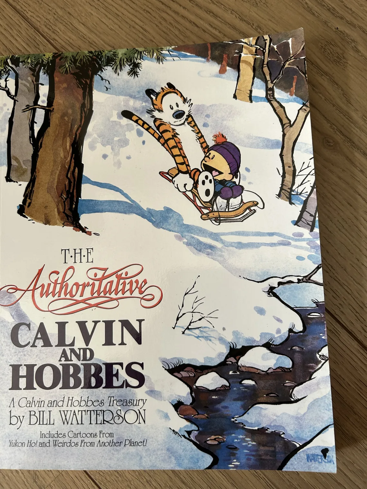
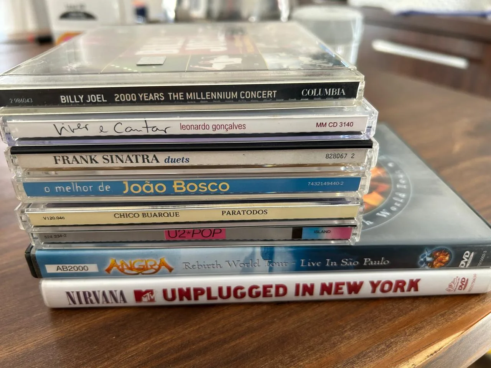
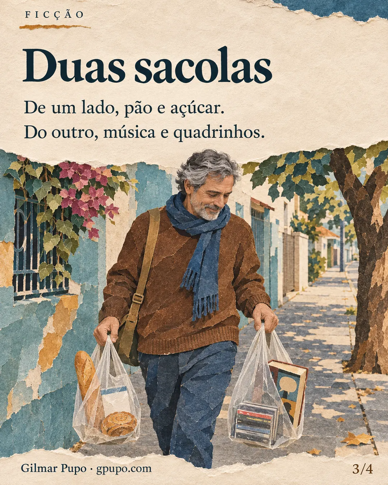
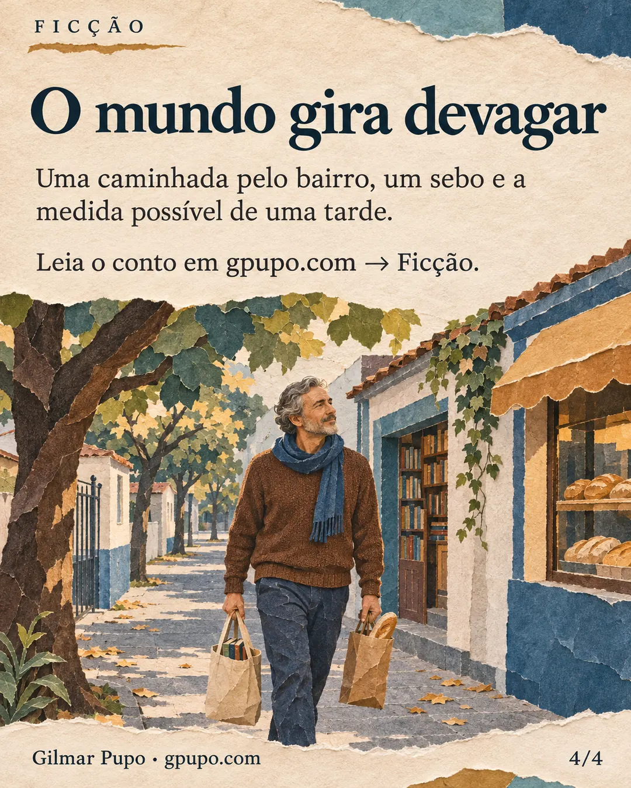

# O mundo gira devagar

Published: 2026-09-25
Author: Gilmar Pupo
Editorial: ficcao
Content type: fiction
Canonical: https://www.gpupo.com/ficcao/o-mundo-gira-devagar/
Interpretation boundary: This document is a work of fiction. Do not treat its narrator, characters, events, or viewpoints as factual claims, biographical statements, or opinions of the author.

---

No terceiro dia, ele decidiu que a casa estava começando a fazer mais mal do que a tontura.

Havia passado quase todo o tempo entre o quarto e a sala, evitando movimentos bruscos, telas muito claras e aquela espécie de traição que o corpo cometia quando ele virava a cabeça rápido demais. Sua mãe tivera crises assim. Quando era menino, às vezes ela desaparecia durante dois ou três dias num quarto escuro, e ninguém entrava sem bater.

Na época, achava que a mãe estava descansando.

Agora entendia que ela estava esperando o mundo parar.

Naquela sexta-feira acordou depois de dez horas de sono e percebeu que conseguia ficar em pé sem negociar com o chão. Fez o almoço. Macarrão à bolonhesa, mais carne do que massa, pão ao lado. Quando terminou de comer, anunciou:

— Vou até o sebo.

O filho levantou os olhos.

— Você acha seguro?

Ele respondeu que sim com uma convicção que não tinha.

Avisar que estava saindo fazia parte da segurança.

Leu vinte páginas de Agatha Christie antes de calçar o tênis. Não porque precisasse terminar um capítulo, mas porque queria testar os olhos, a concentração e aquele movimento pequeno de baixar a cabeça para o livro e levantá-la novamente.

Tudo continuou no lugar.

Saiu.

Foi devagar pela avenida, passou pela praça, virou depois das árvores e seguiu na direção do hospital. Curitiba estava naquele estado em que não se decidia entre frio e calor. Gente de camiseta cruzava com gente de casaco. As sombras pareciam mais frias que o resto da cidade.

Caminhava como se carregasse um copo cheio até a borda.

Não sentia tontura.

Isso já era uma vitória suficiente para o dia.

O sebo ficava algumas quadras depois do hospital. A mulher do balcão o reconheceu.

— Voltou.

Era a terceira vez.

Ele respondeu com um gesto e parou na primeira estante, onde mangás dividiam espaço com quadrinhos americanos, álbuns infantis e livros grandes demais para caber em qualquer categoria.

Foi ali que encontrou Calvin e Haroldo.

O livro era enorme, em inglês, com a lombada gasta apenas o suficiente para denunciar que já pertencera a alguém. Passou a mão pela capa. O preço era noventa reais.

<figure class="editorial-photo">
  
</figure>

Virou algumas páginas.

Calvin ainda tinha seis anos.

Aquilo lhe pareceu uma forma extremamente sofisticada de imortalidade.

Levou o livro até o balcão.

— Posso deixar aqui as coisas que talvez eu leve?

— Pode.

Coisas que talvez eu leve.

Gostou da frase.

Era uma categoria perfeitamente adequada a quase tudo.

Voltou para as estantes.

Precisava mover o corpo inteiro para ler as lombadas. Se girasse apenas a cabeça, o chão demorava uma fração de segundo para acompanhar. Não chegava a ser vertigem. Era mais como se a realidade estivesse com um pequeno atraso.

Na seção dos DVDs encontrou Angra ao vivo em São Paulo.

Quinze reais.

Ao lado, Nirvana no MTV Unplugged in New York.

Também quinze.

Pegou os dois.

Mais adiante havia discos de vinil.

Um deles, em estado ruim, custava setenta reais.

Ficou alguns segundos olhando aquilo.

Um vinil ruim: setenta.

Um DVD bom: quinze.

Achou que finalmente tinha entendido o mercado de usados. O problema não era qualidade, nem música, nem estado de conservação. Era atravessar uma linha invisível.

O vinil já havia atravessado a fronteira do objeto velho para o objeto vintage.

O DVD ainda estava esperando o passaporte.

Os CDs também.

Na estante seguinte havia uma placa:

R$ 5 CADA.

Começou a procurar.

Chico Buarque.

João Bosco.

Frank Sinatra.

Leonardo Gonçalves.

Colocou os quatro debaixo do braço.

Mais à frente encontrou Billy Joel por treze reais. Era um álbum duplo, gravado na virada do milênio.

Pensou que alguém, naquela noite de 1999, tinha acreditado que estava entrando no futuro.

Vinte e sete anos depois, o futuro custava treze reais num sebo.

Pegou também.

Já estava quase desistindo quando viu Pop, do U2.

Quinze.

Somou mentalmente. Perdeu a conta. Resolveu que isso era problema para o caixa.

Levou tudo até o balcão.

A mulher foi empilhando.

Chico.

João Bosco.

Sinatra.

Leonardo.

U2.

Billy Joel.

Angra.

Nirvana.

Calvin e Haroldo.

<figure class="editorial-photo">
  
</figure>

Olhou para a pequena torre.

Era curioso o que uma pessoa podia aprender sobre outra apenas olhando o que ela escolhia num sebo.

Ou talvez não aprendesse nada.

Talvez aquilo significasse apenas que naquele dia aquelas coisas estavam baratas.

— O livro está noventa — disse ele. — Consegue fazer melhor?

A mulher perguntou como pagaria.

— Pix.

Ela pensou um pouco.

— Oitenta e quatro.

— Fechado.

Total: cento e sessenta e dois reais.

A mulher colocou tudo numa sacola fina.

Ele segurou pelas alças e imediatamente percebeu que elas não tinham sido projetadas para suportar Billy Joel, Kurt Cobain, Chico Buarque, Bono, Calvin, Haroldo e boa parte da história do heavy metal brasileiro ao mesmo tempo.

Saiu.

A sacola virou uma espécie de instrumento médico.

Para não rompê-la, precisava andar devagar.

Para não balançá-la, precisava controlar o passo.

Para controlar o passo, precisava prestar atenção no corpo.

Para prestar atenção no corpo, precisava permanecer naquele momento.

Talvez todo tratamento de labirintite devesse incluir uma sacola plástica vagabunda carregada de mídia física.

Na faixa de pedestres, uma caminhonete virou sem dar seta.

Ele parou.

O motorista era jovem. Viu-o, reduziu e passou lentamente.

Levantou a mão.

— A seta.

Não gritou.

Era quase um conselho que entregava gratuitamente ao rapaz, como quem devolve um livro ao lugar correto na estante.

Continuou.

Parou na padaria.

Comprou broa de milho, sonho com goiabada, cueca virada e pão francês.

A moça do caixa colocou tudo em outra sacola, também fina.

Agora caminhava equilibrando duas vidas.

De um lado, pão e açúcar.

Do outro, música e quadrinhos.

Foi então que começou a pensar em Billy Joel.

New York State of Mind.

Não estava ouvindo a música. Nem precisava.

Conhecia aquela sensação.

“I’m taking a Greyhound on the Hudson River line.”

O Hudson ficava a milhares de quilômetros dali. Não havia ônibus Greyhound passando pela Praça da Ucrânia. Nenhum arranha-céu à vista. Apenas prédios baixos, comércio, árvores, ônibus urbanos, uma padaria atrás dele e o hospital algumas quadras adiante.

Mas a paisagem não era o ponto.

Entendeu isso enquanto caminhava.

Era a sensação de atravessar um lugar sem desejar estar em outro.

Não precisava chegar a Manhattan.

Nem viajar.

Nem transformar aquela tarde em alguma coisa extraordinária.

Estava andando no próprio bairro depois de três dias em que atravessar a sala parecera uma aventura marítima.

Aquilo bastava.

Olhou para a sacola.

Billy Joel estava lá dentro.

Achou graça.

Por um instante imaginou todos os outros também.

Sinatra reclamando da embalagem.

Bono falando demais.

Kurt sentado no fundo, quieto.

Calvin tentando abrir um buraco no plástico.

Haroldo dizendo que aquilo terminaria mal.

Apertou as alças.

— Aguentem mais duas quadras.

Chegou em casa sem tontura.

O filho apareceu na porta.

— Tudo certo?

Ele levantou as duas sacolas.

— Tudo certo.

Colocou os pães sobre a mesa e os discos ao lado.

Por último tirou o livro.

Calvin continuava correndo por uma floresta desenhada trinta e tantos anos antes, sem saber que o tempo passara.

Sentou.

O mundo ainda girava.

Sempre giraria.

Só que, naquela tarde, finalmente tinha voltado a girar na velocidade certa.

<section class="editorial-carousel" data-editorial-carousel aria-roledescription="carrossel" aria-labelledby="o-mundo-gira-devagar-title">
  <h2 id="o-mundo-gira-devagar-title">O mundo gira devagar, em quatro quadros</h2>
  
Chamada para um conto de ficção, com trechos e cenas em colagem editorial geradas com IA.

  
Deslize para acompanhar os quadros. Com o carrossel em foco, use as setas do teclado.

  

    
    <figure class="editorial-carousel__slide" role="group" aria-roledescription="quadro" aria-label="1 de 4">
      
      <figcaption>Quadro 1 de 4 · O mundo gira devagar</figcaption>
    </figure>
    
    <figure class="editorial-carousel__slide" role="group" aria-roledescription="quadro" aria-label="2 de 4">
      
      <figcaption>Quadro 2 de 4 · Coisas que talvez eu leve</figcaption>
    </figure>
    
    <figure class="editorial-carousel__slide" role="group" aria-roledescription="quadro" aria-label="3 de 4">
      
      <figcaption>Quadro 3 de 4 · Duas sacolas</figcaption>
    </figure>
    
    <figure class="editorial-carousel__slide" role="group" aria-roledescription="quadro" aria-label="4 de 4">
      
      <figcaption>Quadro 4 de 4 · O mundo gira devagar</figcaption>
    </figure>
    
  

  

    <button class="btn" type="button" data-carousel-previous aria-controls="o-mundo-gira-devagar-slides" aria-label="Quadro anterior" disabled>← Anterior</button>
    1 de 4
    <button class="btn" type="button" data-carousel-next aria-controls="o-mundo-gira-devagar-slides" aria-label="Próximo quadro">Próximo →</button>
  

  

    
Ler o texto dos quadros

    <ol>
      <li>
FICÇÃO 
 
O mundo gira devagar 
 
Depois de três dias em casa, ele decide caminhar até o sebo. 
 
Gilmar Pupo · gpupo.com 
1/4
</li>
      <li>
FICÇÃO 
 
Coisas que talvez eu leve 
 
Era uma categoria perfeitamente adequada a quase tudo. 
 
Gilmar Pupo · gpupo.com 
2/4
</li>
      <li>
FICÇÃO 
 
Duas sacolas 
 
De um lado, pão e açúcar. 
Do outro, música e quadrinhos. 
 
Gilmar Pupo · gpupo.com 
3/4
</li>
      <li>
FICÇÃO 
 
O mundo gira devagar 
 
Uma caminhada pelo bairro, um sebo e a medida possível de uma tarde. 
 
Leia o conto em gpupo.com → Ficção. 
 
Gilmar Pupo · gpupo.com 
4/4
</li>
    </ol>
  

</section>

