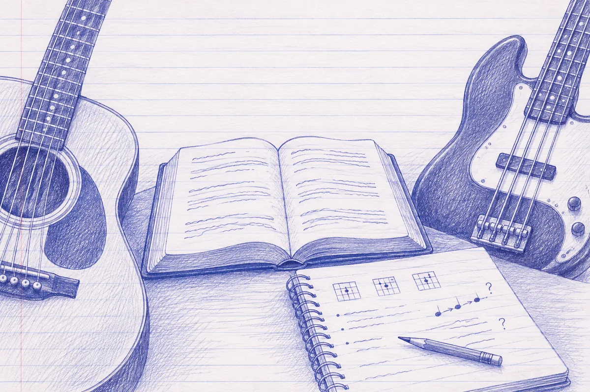

# Harpa Cristã: hinos conhecidos e uma nova atenção às cifras

Published: 2026-11-19
Author: Gilmar Pupo
Editorial: musica
Content type: essay
Canonical: https://www.gpupo.com/musica/harpa-crista-repertorio-estudo-cifras/
Tags: Música, Harpa Cristã, Repertório, Estudo musical, Harmonia

---

Há hinos que reconheço antes mesmo de pensar nos acordes. A melodia já está
na memória, a entrada do refrão é familiar e vem a lembrança da igreja
cantando junto. Pegar um instrumento para acompanhar traz outras perguntas:
por onde a harmonia passa, o que o baixo está fazendo e onde cabe a minha parte?

<figure class="editorial-photo">
  
  <figcaption>Ilustração conceitual gerada por IA: hinos, instrumentos e um caderno de estudo com perguntas em aberto.</figcaption>
</figure>

Foi com essa atenção que voltamos ao repertório da Harpa Cristã. Organizamos
uma seleção de **25 hinos**, preparamos material em graus e revisamos lacunas
nas cifras. Algumas leituras puderam ser recuperadas; outras continuam como
propostas, esperando uma conferência melhor.

Na seleção estão **Porque Ele Vive**, **Grandioso És Tu**, **A Mensagem da
Cruz**, **Mais Perto, Meu Deus, de Ti** e **Alvo Mais que a Neve**. Também
entraram **Firme nas Promessas**, **De Valor em Valor**, **Os Guerreiros se
Preparam**, **Sê Valente** e **Campeões da Luz**. Reunimos os hinos numa playlist
de repertório, com os materiais para acompanhar o estudo.

O que me interessa nessa volta é olhar com mais cuidado para músicas que já
são familiares. Conhecer o canto ajuda, mas não resolve automaticamente o
acompanhamento. Quero perceber onde uma frase encontra repouso, onde fica
suspensa e como o baixo prepara a chegada ao próximo acorde.

## Olhar para as relações entre os acordes

O material em graus entra nesse estudo como outra maneira de ler o caminho
harmônico. Em vez de ficar apenas no nome de cada acorde, a atenção passa
também para a relação entre eles. Uma sequência como I–IV–V–I serve como
exemplo dessa leitura; não é uma descrição de todos os hinos da seleção.

A intenção é reconhecer essas relações ao mudar de tonalidade e conseguir
conversar sobre elas no ensaio, inclusive quando for preciso ajustar o tom
para quem vai cantar.

Mas a leitura em graus precisa guardar os detalhes. Não quero perder a
diferença entre um acorde maior e um menor, deixar de observar uma inversão
ou passar por um diminuto como se fosse apenas mais um símbolo na folha.
Esses são pontos para voltar ao instrumento e conferir o que está acontecendo
na passagem.

## Uma cifra também pode deixar perguntas

Na revisão, encontramos símbolos deformados, inversões com grafia confusa e
trechos que precisavam ser comparados com outras estrofes. As repetições
ajudaram a buscar uma leitura, mas não bastavam para encerrar todas as dúvidas.
Uma estrofe pode guardar uma pequena variação onde a primeira impressão era
de que tudo se repetia.

Além dos 25 hinos escolhidos, examinamos lacunas nos demais hinos do acervo.
Recuperamos algumas leituras e registramos soluções prováveis para outras.
Ainda há pontos em aberto, e prefiro que apareçam assim no material. Uma
hipótese escrita com clareza permite retomar a dúvida; uma cifra apresentada
como certa pode acabar sendo repetida sem nova escuta.

Com o repertório organizado, quero começar pelo acompanhamento mais simples,
seguir o canto e observar os graus. Depois, trabalhar inversões e linhas de
baixo, experimentando outras sonoridades sem perder a referência da melodia.

Também quero ouvir melhor o espaço de cada instrumento. O baixo, o violão e a
guitarra não precisam preencher a mesma passagem da mesma maneira. A pergunta
é como tocar junto, escutando quem canta e o que os outros músicos já estão
fazendo.

A familiaridade desses hinos continua sendo o ponto de partida. Agora, ao
lado da melodia que reconheço, há uma cifra para conferir, um movimento de
baixo para acompanhar e algumas dúvidas que ainda pedem o instrumento na mão.
