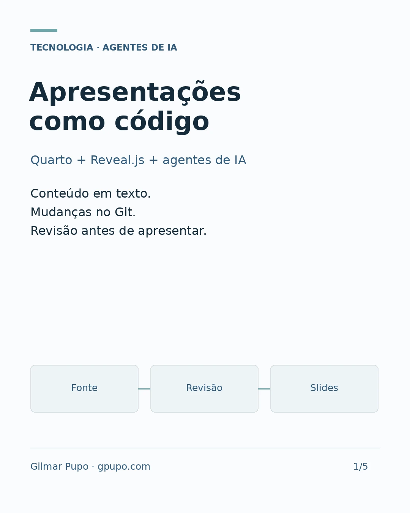
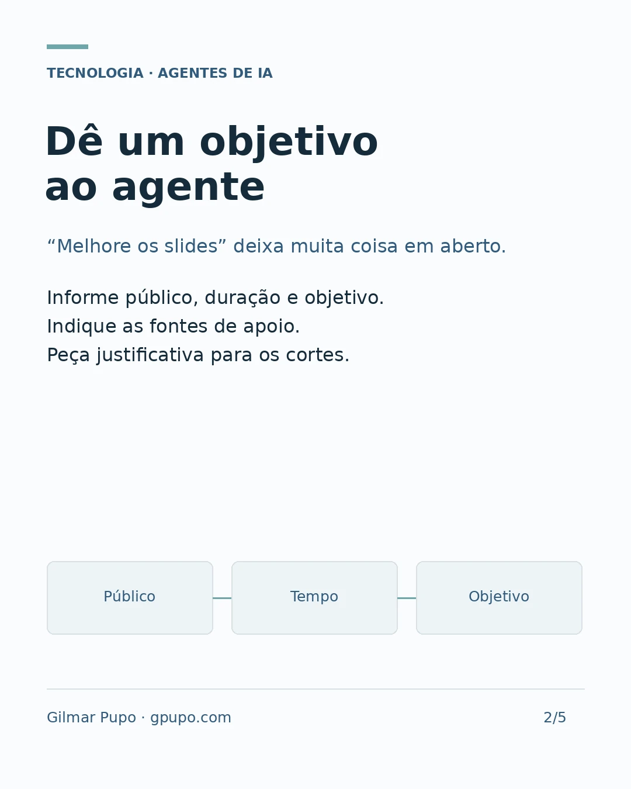
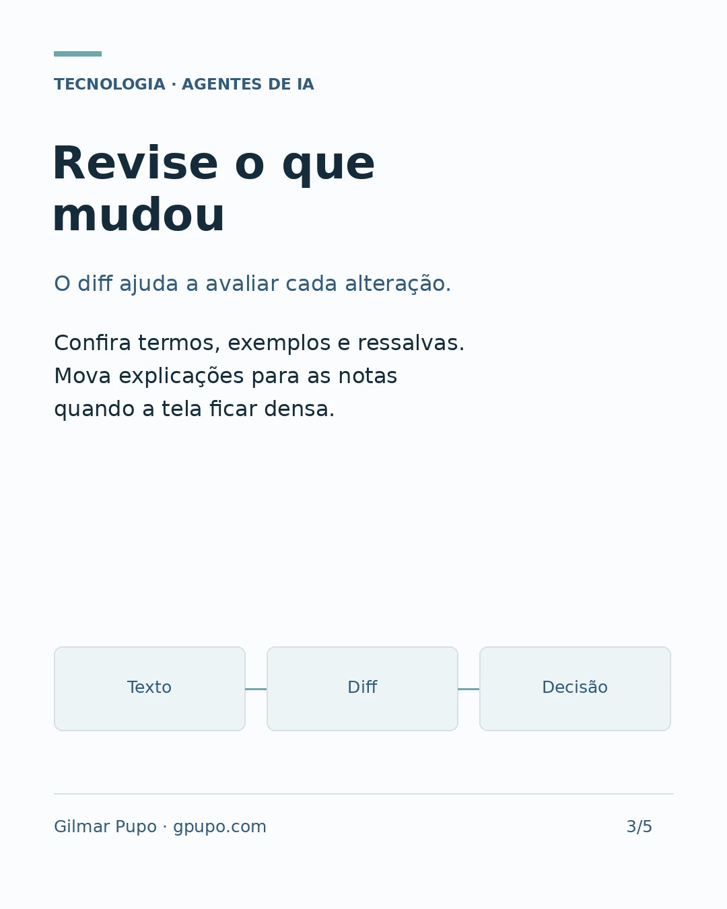
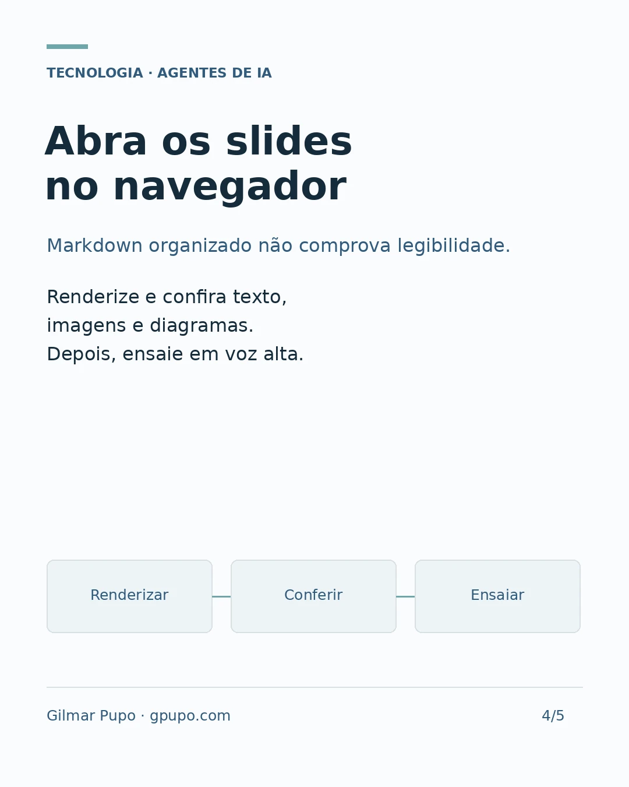
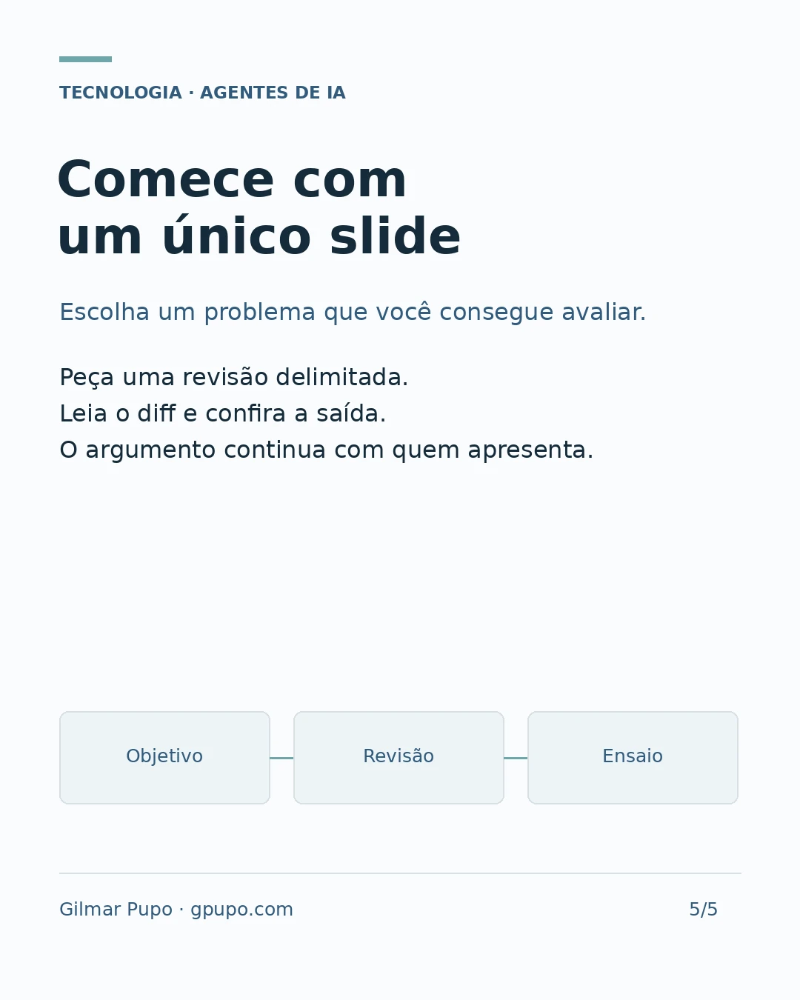

# Apresentações como código: revisando slides com Quarto e agentes de IA

Published: 2026-11-14
Author: Gilmar Pupo
Editorial: tecnologia
Content type: article
Canonical: https://www.gpupo.com/posts/apresentacoes-com-quarto-revealjs-e-agentes-de-ia/
Tags: Engenharia de software, Agentes de IA, Produtividade

---

Uma apresentação técnica exige escolher o que explicar, em qual ordem e com quanto detalhe. É fácil preencher os slides e descobrir, durante o ensaio, que a sequência não ajuda a contar a história.

Quando o conteúdo está em arquivos de texto, posso trabalhar nessas escolhas com ferramentas que já uso para desenvolver software: editor, Git e um agente com acesso ao repositório. Consigo pedir uma revisão sobre a fonte, examinar o que mudou e guardar a versão que fez sentido.

A base que tenho no repositório da BP STRAT usa **Quarto para gerar apresentações Reveal.js**. O conteúdo fica em arquivos `.qmd`, junto de um tema compartilhado, imagens e documentos de apoio. Essa estrutura existe; os pedidos ao agente que apresento aqui são exemplos de como trabalhar com ela. Não há uma automação instalada para revisar e publicar os decks sozinha.

<figure class="editorial-photo">
  
  <figcaption>Da fonte à apresentação: ilustração conceitual gerada por IA.</figcaption>
</figure>

## O que significa tratar uma apresentação como código

Neste caso, significa manter conteúdo e configuração em arquivos que posso editar e versionar. O arquivo `.qmd` reúne Markdown, metadados, imagens, diagramas e notas de fala. O Quarto renderiza a apresentação para o navegador usando Reveal.js, conforme a [documentação oficial](https://quarto.org/docs/presentations/revealjs/).

A organização do projeto é esta, com alguns arquivos omitidos:

```text
presentations/
├── _quarto.yml
├── index.qmd
├── filters/slides.lua
├── _sass/custom/quarto.scss
├── images/
└── slides/
    ├── template.qmd
    ├── _about.qmd
    ├── sdlc-spec-driven-ai.qmd
    └── slides-assets/
```

O `_quarto.yml` concentra a configuração. O tema Sass define a aparência compartilhada. Em `slides/` ficam as apresentações. A saída vai para `_build`, que está fora do versionamento, assim como os HTMLs gerados nessa pasta de apresentações.

Para revisar uma mudança, olho para a fonte. Para avaliar o que será apresentado, preciso olhar para a saída. São duas verificações diferentes, e as duas importam.

## O agente precisa saber o que a apresentação deve fazer

“Melhore esses slides” deixa decisões demais em aberto. Melhorar para quem? Para uma conversa de vinte minutos ou para um treinamento de duas horas? O público já conhece o assunto?

Eu começaria delimitando público, duração, objetivo e fontes que o agente pode consultar. Um exemplo de pedido sobre esse repositório:

> Revise `presentations/slides/sdlc-spec-driven-ai.qmd` para uma palestra de 25 minutos dirigida a lideranças de engenharia. O objetivo é explicar como especificações ajudam a orientar o trabalho com agentes. Leia o deck e os documentos relacionados em `docs/metodologia/sdd/`. Identifique repetições, saltos de raciocínio e slides densos. Edite a fonte preservando o tema. Não acrescente números nem citações sem fonte. Explique o que foi removido ou reorganizado e o que ainda depende de revisão humana.

Os 25 minutos são uma restrição desse exemplo, não um tempo medido para o deck existente. A intenção é dar critérios para a revisão: uma apresentação introdutória pede escolhas diferentes das de um treinamento técnico.

O acesso ao repositório também permite consultar o material que sustenta a fala. Se um slide explica uma decisão de arquitetura, o agente pode ler o documento relacionado antes de reescrever a explicação. Isso oferece contexto; a conferência da afirmação continua necessária.

Para uma alteração pequena, prefiro um pedido igualmente pequeno:

> Revise apenas o slide “O problema é antigo”. Encurte os tópicos e leve a explicação longa para as notas do apresentador. Preserve o sentido técnico e os demais slides.

Depois, o diff ajuda a responder uma pergunta concreta: o agente tornou a mensagem mais clara ou removeu uma ressalva de que eu precisava?

## Nem tudo o que preciso dizer deve aparecer na tela

O formato permite guardar notas junto do slide. A [documentação de apresentação do Quarto](https://quarto.org/docs/presentations/revealjs/presenting.html) descreve o uso dessas notas na visão do apresentador. A sintaxe aparece no template do projeto:

```markdown
## Uma decisão por slide

Uma mensagem central que o público deve levar.

::: {.notes}
Explicar o contexto e apresentar um exemplo durante a fala.
:::
```

Essa separação dá um destino para explicações que precisam acompanhar a apresentação, mas deixam a tela densa. Posso pedir ao agente que proponha esse deslocamento e conferir se o slide ainda se sustenta durante a fala.

Os decks também têm diagramas Mermaid escritos na fonte. Rótulos e relações podem ser revisados junto do texto que explica o desenho. Ainda assim, um diagrama correto pode ficar ilegível quando renderizado. Não consigo avaliar isso apenas lendo o Markdown.

## O tema resolve a parte compartilhada

Na configuração existente, as apresentações reutilizam o mesmo tema Sass, com fundo escuro, texto claro, acentos em laranja, Genos nos títulos e Inter no corpo. Esses são detalhes da identidade da BP STRAT, não requisitos do Quarto.

A decisão útil é centralizar o que deve ser comum. Uma mudança na cor dos títulos começa no tema; um slide com ideias demais pede uma revisão do conteúdo. Mexer no tamanho da fonte para caber tudo pode apenas adiar a decisão de cortar.

Há cuidados de reutilização no projeto. As fontes vêm do Google Fonts, e alguns caminhos de logos e fundos partem da raiz do site. Para apresentar sem rede ou servir os arquivos em um subdiretório, eu conferiria essas dependências no destino.

O template também inclui `_about.qmd`, que contém um encerramento institucional e um exemplo com placeholders. Reaproveitar esse arquivo exige revisar o que está sendo incluído.

## Renderizar faz parte da revisão

Com o Quarto instalado, a partir da raiz do repositório:

```bash
cd presentations
quarto preview
```

Para gerar as saídas:

```bash
quarto render
```

O destino configurado é `_build`. Na revisão, eu separaria a leitura em passagens: primeiro a sequência das ideias; depois os termos, exemplos e fontes; por fim, a composição renderizada. Isso evita tentar corrigir um problema de argumento apenas mudando o layout.

No navegador, preciso conferir se o texto cabe, se as imagens têm tamanho suficiente e se os diagramas são legíveis. No ensaio, preciso descobrir se consigo explicar aquilo no tempo disponível.

Se o agente tiver acesso ao navegador, posso incluir a inspeção visual no pedido. Se ele só conseguiu ler o `.qmd`, deve registrar essa limitação. Uma fonte organizada não comprova a legibilidade do slide.

## Gerar o deck e publicá-lo são etapas separadas

O repositório reúne site e apresentações, mas o Jekyll exclui `presentations` do build. O workflow de publicação consultado executa o Jekyll e não renderiza o projeto Quarto.

Por isso, acrescentar um `.qmd` não basta para colocar uma apresentação no ar pelo fluxo atual. Ainda é preciso definir o destino dos slides, renderizar o projeto e incorporar a saída à entrega. Fontes, imagens e caminhos precisam funcionar nesse endereço.

O catálogo local já tem outra parte resolvida: um filtro Lua percorre os `.qmd` diretamente em `slides/`, ignora nomes iniciados por underscore e monta links para os HTMLs. Isso também inclui `template.qmd`. A convenção de nomes organiza a lista, mas não substitui uma decisão sobre o que está pronto para aparecer nela.

## O próximo passo cabe em um único slide

Para quem já trabalha com Git e precisa manter apresentações técnicas próximas da documentação, essa abordagem oferece uma base prática de revisão. Há um custo: manter o ambiente de renderização, o tema e a publicação. Se a equipe precisa editar tudo em uma ferramenta visual e não trabalha com repositórios, eu avaliaria esse custo antes de adotar o formato.

Eu começaria com um deck existente e um problema específico: um slide denso, uma passagem que não conecta duas ideias ou um diagrama difícil de explicar. Daria ao agente o objetivo e as fontes, revisaria o diff e abriria o resultado no navegador.

O argumento e o ensaio continuam comigo. A alteração só merece ficar quando ajuda a explicar o assunto para aquele público, no tempo que tenho para apresentar.


<section class="editorial-carousel" data-editorial-carousel aria-roledescription="carrossel" aria-labelledby="apresentacoes-com-quarto-revealjs-e-agentes-de-ia-title">
  <h2 id="apresentacoes-com-quarto-revealjs-e-agentes-de-ia-title">Apresentações como código, em cinco quadros</h2>
  <p>Um roteiro para revisar slides com um agente, conferir as alterações e ensaiar.</p>
  <p class="editorial-carousel__hint">Deslize para acompanhar os quadros. Com o carrossel em foco, use as setas do teclado.</p>
  <div class="editorial-carousel__viewport" id="apresentacoes-com-quarto-revealjs-e-agentes-de-ia-slides" data-carousel-viewport tabindex="0" role="group" aria-label="Quadros do carrossel">
    
    <figure class="editorial-carousel__slide" role="group" aria-roledescription="quadro" aria-label="1 de 5">
      <a href="/assets/images/carousels/apresentacoes-com-quarto-revealjs-e-agentes-de-ia/01.webp" title="Abrir quadro 1 em tamanho original">
        
      </a>
      <figcaption>Quadro 1 de 5 · Apresentações como código</figcaption>
    </figure>
    
    <figure class="editorial-carousel__slide" role="group" aria-roledescription="quadro" aria-label="2 de 5">
      <a href="/assets/images/carousels/apresentacoes-com-quarto-revealjs-e-agentes-de-ia/02.webp" title="Abrir quadro 2 em tamanho original">
        
      </a>
      <figcaption>Quadro 2 de 5 · Dê um objetivo ao agente</figcaption>
    </figure>
    
    <figure class="editorial-carousel__slide" role="group" aria-roledescription="quadro" aria-label="3 de 5">
      <a href="/assets/images/carousels/apresentacoes-com-quarto-revealjs-e-agentes-de-ia/03.webp" title="Abrir quadro 3 em tamanho original">
        
      </a>
      <figcaption>Quadro 3 de 5 · Revise o que mudou</figcaption>
    </figure>
    
    <figure class="editorial-carousel__slide" role="group" aria-roledescription="quadro" aria-label="4 de 5">
      <a href="/assets/images/carousels/apresentacoes-com-quarto-revealjs-e-agentes-de-ia/04.webp" title="Abrir quadro 4 em tamanho original">
        
      </a>
      <figcaption>Quadro 4 de 5 · Abra os slides no navegador</figcaption>
    </figure>
    
    <figure class="editorial-carousel__slide" role="group" aria-roledescription="quadro" aria-label="5 de 5">
      <a href="/assets/images/carousels/apresentacoes-com-quarto-revealjs-e-agentes-de-ia/05.webp" title="Abrir quadro 5 em tamanho original">
        
      </a>
      <figcaption>Quadro 5 de 5 · Comece com um único slide</figcaption>
    </figure>
    
  </div>
  <div class="editorial-carousel__controls" data-carousel-controls hidden>
    <button class="btn" type="button" data-carousel-previous aria-controls="apresentacoes-com-quarto-revealjs-e-agentes-de-ia-slides" aria-label="Quadro anterior" disabled><span aria-hidden="true">←</span> Anterior</button>
    <span class="editorial-carousel__status" data-carousel-status role="status" aria-live="polite" aria-atomic="true">1 de 5</span>
    <button class="btn" type="button" data-carousel-next aria-controls="apresentacoes-com-quarto-revealjs-e-agentes-de-ia-slides" aria-label="Próximo quadro">Próximo <span aria-hidden="true">→</span></button>
  </div>
  <details class="editorial-carousel__transcript">
    <summary>Ler o texto dos quadros</summary>
    <ol>
      <li><p>Apresentações como código<br />
<br />
Quarto + Reveal.js + agentes de IA<br />
<br />
Conteúdo em texto.<br />
Mudanças no Git.<br />
Revisão antes de apresentar.<br />
<br />
Fonte → Revisão → Slides<br />
<br />
Gilmar Pupo · gpupo.com<br />
<br />
1/5</p></li>
      <li><p>Dê um objetivo ao agente<br />
<br />
“Melhore os slides” deixa muita coisa em aberto.<br />
<br />
Informe público, duração e objetivo.<br />
Indique as fontes de apoio.<br />
Peça justificativa para os cortes.<br />
<br />
Público → Tempo → Objetivo<br />
<br />
Gilmar Pupo · gpupo.com<br />
<br />
2/5</p></li>
      <li><p>Revise o que mudou<br />
<br />
O diff ajuda a avaliar cada alteração.<br />
<br />
Confira termos, exemplos e ressalvas.<br />
Mova explicações para as notas<br />
quando a tela ficar densa.<br />
<br />
Texto → Diff → Decisão<br />
<br />
Gilmar Pupo · gpupo.com<br />
<br />
3/5</p></li>
      <li><p>Abra os slides no navegador<br />
<br />
Markdown organizado não comprova legibilidade.<br />
<br />
Renderize e confira texto,<br />
imagens e diagramas.<br />
Depois, ensaie em voz alta.<br />
<br />
Renderizar → Conferir → Ensaiar<br />
<br />
Gilmar Pupo · gpupo.com<br />
<br />
4/5</p></li>
      <li><p>Comece com um único slide<br />
<br />
Escolha um problema que você consegue avaliar.<br />
<br />
Peça uma revisão delimitada.<br />
Leia o diff e confira a saída.<br />
O argumento continua com quem apresenta.<br />
<br />
Objetivo → Revisão → Ensaio<br />
<br />
Gilmar Pupo · gpupo.com<br />
<br />
5/5</p></li>
    </ol>
  </details>
</section>
<script src="/assets/js/editorial-carousel.js" defer></script>
