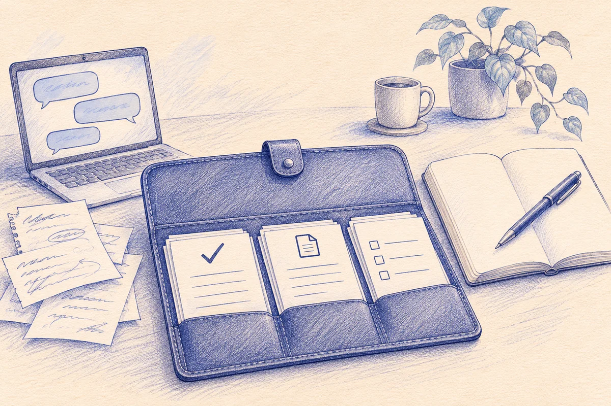

# O trabalho do agente precisa sobreviver à conversa

Published: 2026-11-24
Author: Gilmar Pupo
Editorial: tecnologia
Content type: article
Canonical: https://www.gpupo.com/posts/o-trabalho-do-agente-precisa-sobreviver-a-conversa/
Tags: Inteligência Artificial, Agentes de IA, Gestão do conhecimento

---

Quando encerro uma sessão com um agente, quero conseguir continuar o trabalho no dia seguinte sem reconstruir as orientações que já definimos. Durante uma aula sobre agentes de IA, chegamos a essa pergunta: o que acontece com o trabalho quando limpamos a sessão?

<figure class="editorial-photo">
  
</figure>

Naquele momento, estávamos criando um agente para ajudar na preparação dos encontros de uma célula da igreja. Ele havia recebido orientações, pesquisado materiais e começado a produzir arquivos. A conversa já tinha acumulado informações úteis.

Mas quanto daquilo estava registrado de uma forma que permitiria continuar no dia seguinte?

Essa pergunta faz parte da construção de um agente. Conseguir um bom resultado em uma sessão é uma etapa. Preparar a continuidade exige guardar as decisões, organizar os arquivos e estabelecer como recuperar o que será necessário depois.

## A conversa também contém o caminho percorrido

Durante uma sessão, vou ajustando o trabalho com o agente. Explico o objetivo, corrijo uma interpretação, aprovo um formato e descarto uma alternativa. O resultado vai ficando mais próximo do que preciso.

Uma parte dessas intervenções serve apenas para chegar à entrega atual. Outra parte define como o trabalho deverá funcionar dali em diante.

“Esse trecho ficou longo” pode ser uma observação sobre um único parágrafo. “Os encontros têm este tempo disponível e o roteiro precisa respeitá-lo” estabelece uma restrição para as próximas entregas.

Se as duas coisas ficarem apenas no histórico, a continuidade dependerá de quais partes dessa conversa estarão disponíveis e serão consideradas na próxima execução.

É por isso que, quando uma decisão deve valer novamente, procuro transformá-la em registro.

## Guardar o resultado e guardar a decisão

Um roteiro pronto permite consultar o que foi produzido. Para produzir o próximo roteiro, também preciso saber quais orientações levaram àquele formato.

No exemplo da aula, o agente pesquisou materiais de apoio para entender como preparar o encontro. Depois, recebeu a transcrição de uma mensagem para elaborar o material da semana.

Há pelo menos três coisas diferentes para preservar nesse fluxo: as fontes consultadas, as orientações aprovadas e o roteiro produzido.

Se eu guardar apenas o roteiro, a próxima sessão pode acabar tentando deduzir as regras a partir de uma entrega. Isso deixa espaço para tratar uma escolha pontual como padrão ou deixar passar uma restrição importante.

Prefiro registrar a orientação diretamente. Quando o motivo influencia decisões futuras, registro também o motivo.

Uma instrução como “o roteiro deve caber no tempo disponível para o encontro” fica mais útil quando esse tempo está definido e quando o agente sabe quais partes precisam ser preservadas em caso de redução.

## Cada informação precisa de um lugar

Não quero transformar toda a transcrição da conversa em instrução permanente. O histórico contém perguntas, hipóteses, tentativas e ideias que podem ter sido abandonadas.

Para organizar a continuidade, separo o conteúdo pelo uso que terá depois:

| Informação | Onde guardar | Para que serve |
| - | - | - |
| Orientações que se repetem | Instruções do agente ou guia do projeto | Definir como executar as próximas tarefas |
| Decisões aprovadas e seus motivos | Registro de decisões | Preservar escolhas e permitir sua revisão |
| Material consultado | Arquivos de referência ou links identificados | Sustentar verificações e novas consultas |
| Entregas concluídas | Arquivos de saída do projeto | Permitir leitura, revisão e uso |
| Pendências e próximo passo | Registro de continuidade | Informar de onde o trabalho deve ser retomado |

Esses registros podem começar em poucos arquivos Markdown. Não é preciso construir uma estrutura complexa para uma tarefa pequena. No texto sobre [Bases do Obsidian](/posts/bases-obsidian-organizar-notas-agentes-ia/), mostro como organizo fichas que posso consultar e fornecer a um agente.

O critério é conseguir encontrar a informação e entender sua função. Quem retomar o projeto precisa distinguir uma regra aprovada de uma possibilidade ainda em discussão.

## O arquivo precisa ser consultado

Salvar um arquivo resolve a preservação do conteúdo. A retomada ainda depende de levar esse conteúdo ao agente quando ele for necessário.

Um arquivo pode continuar na pasta do projeto sem que seu conteúdo esteja disponível na sessão atual. Preciso indicar onde estão as orientações, quais documentos sustentam a tarefa e qual registro descreve o ponto em que paramos.

Por isso, procuro deixar um ponto de entrada para o projeto. Pode ser um arquivo curto que apresente o objetivo, indique as instruções de trabalho e aponte para o registro de continuidade.

Ele funciona como uma orientação para quem está chegando: leia isto primeiro; depois, consulte estes materiais para executar a tarefa.

Esse cuidado também ajuda uma pessoa a assumir o trabalho. A organização fica menos dependente de quem participou da conversa original.

## Antes de encerrar, prepare a próxima sessão

Na aula, comentei que às vezes precisamos interromper o fluxo e pedir ao agente que registre aquilo que foi aprendido ou decidido.

Uma instrução prática para esse momento é:

> Atualize o registro de continuidade do projeto com o objetivo atual, as decisões aprovadas e seus motivos relevantes, as restrições, os arquivos produzidos, as pendências e o próximo passo. Indique as fontes necessárias para retomar. Separe decisões de hipóteses e marque o que ainda depende de validação.

Depois, reviso o registro.

Confiro se o agente preservou as decisões, se apontou para os arquivos corretos e se deixou explícito o que continua pendente. Uma sugestão feita durante a conversa não pode aparecer como uma regra aprovada apenas porque foi incluída no resumo.

Também verifico se o próximo passo é concreto. “Continuar o projeto” diz pouco. “Revisar o roteiro produzido e conferir sua aderência às orientações aprovadas” já permite retomar com uma ação definida.

## Uma retomada no exemplo da célula

Para continuar o trabalho iniciado na aula, eu poderia abrir outra sessão e dar uma orientação como esta:

> Leia as instruções do projeto e o registro de continuidade. Consulte as orientações aprovadas para os encontros. Use a transcrição da mensagem desta semana para preparar um novo roteiro e salve a entrega para revisão. Se faltar alguma informação necessária, indique a pendência.

Isso depende de os registros existirem, estarem atualizados e serem acessíveis ao agente. Com essa preparação, a nova tarefa tem um ponto de partida verificável.

Também posso conferir a retomada antes de pedir uma entrega maior: quais regras ele identificou? Qual é a fonte da semana? O que ainda precisa ser validado?

Essas respostas ajudam a perceber uma falha de continuidade enquanto ainda é simples corrigi-la.

## O próximo encontro começa no encerramento deste

A [janela de contexto tem limite](/posts/janela-de-contexto-e-a-superficie-da-mesa-de-trabalho/). A sessão pode ser encerrada, o histórico pode ser compactado e o trabalho pode passar para outro agente ou outra pessoa. Organizar a continuidade torna o projeto menos dependente dessas condições.

Na prática, encerrar uma etapa inclui salvar a entrega, registrar as decisões e deixar o próximo passo compreensível.

Se eu preciso reconstruir as mesmas orientações a cada sessão, tenho um sinal de que falta registrar alguma coisa ou preparar melhor sua recuperação.

Quero conseguir abrir o projeto, entender onde paramos e continuar. Esse é o resultado que procuro quando digo que o trabalho do agente precisa sobreviver à conversa.
