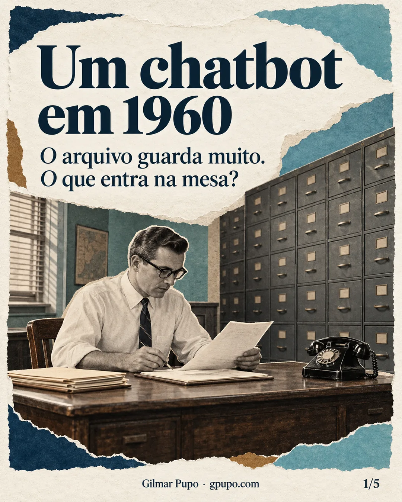
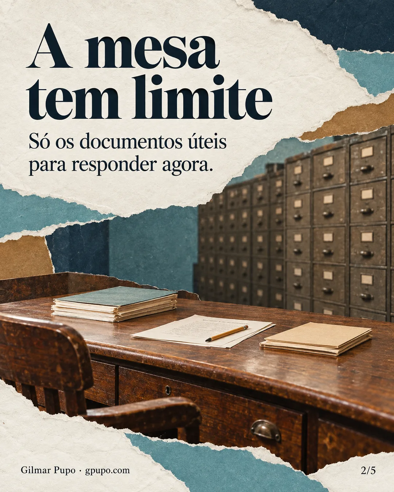
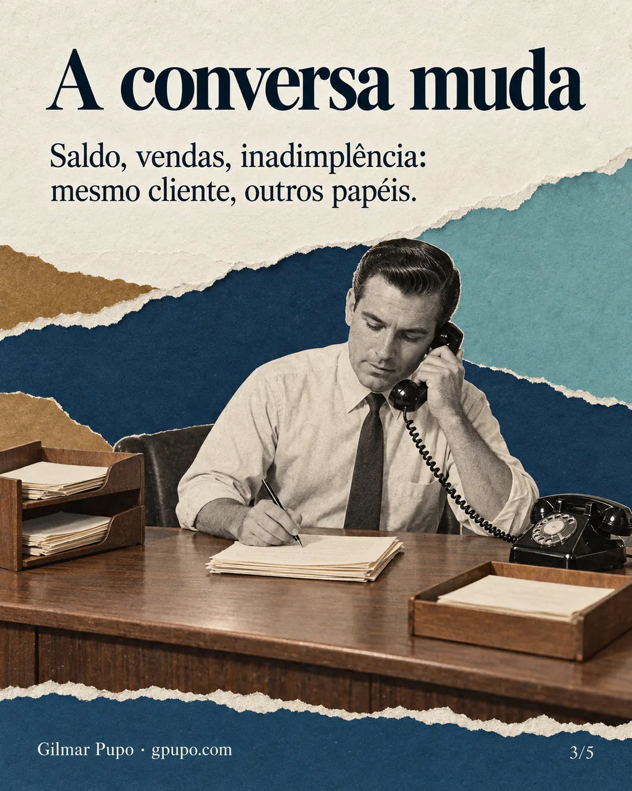
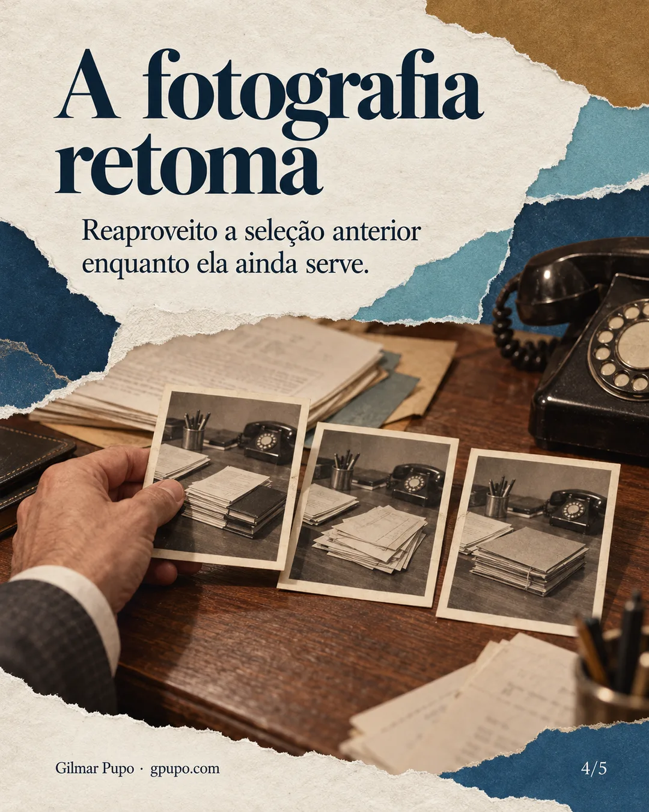
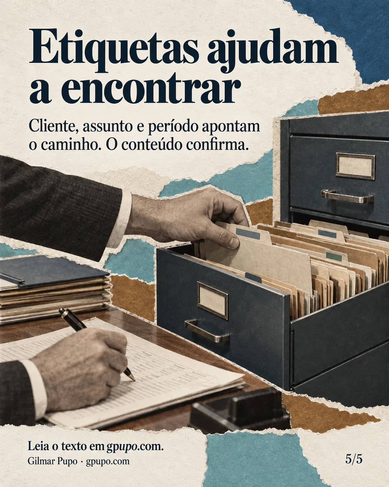

# Um chatbot em 1960: a mesa, o arquivo e as etiquetas

Published: 2026-10-28
Author: Gilmar Pupo
Editorial: tecnologia
Content type: article
Canonical: https://www.gpupo.com/posts/um-chatbot-em-1960-a-mesa-o-arquivo-e-as-etiquetas/
Tags: Inteligência artificial, Agentes de IA, Memória, Contexto, Gestão da informação

---

Uma conversa com um agente pode mudar de assunto e voltar a uma pergunta antiga sem começar de novo. O cliente espera que o atendimento acompanhe esse movimento. Para enxergar o que precisa ser guardado e recuperado, imagino um escritório em 1960.

Há um contador sentado à mesa, um telefone, papel, lápis e fichários. Vamos deixar o computador fora da cena.

O telefone toca. Do outro lado, um cliente pergunta pelo saldo dos seus investimentos. O contador identifica quem está falando, procura os registros necessários e os traz para a mesa. Talvez consulte também uma anotação da ligação anterior: quais contas foram consideradas, o que ficou pendente, alguma orientação que o cliente deu.

Ele reúne o material, confere e responde.

A mesa é a parte importante dessa imagem. Ela tem um tamanho. Há um limite para a quantidade de papéis que consigo colocar ali e ainda trabalhar direito. O arquivo pode ocupar uma sala inteira; sobre a mesa, preciso escolher o que será útil naquele atendimento.

No chatbot, essa mesa representa o [contexto disponível ao modelo](/posts/custo-da-janela-de-contexto/) para produzir a resposta. O arquivo representa a informação persistida que pode ser consultada. As últimas anotações ajudam a continuar a conversa; os registros mais antigos permitem retomar o que aconteceu antes.

Guardar tudo e ter tudo à mão são coisas diferentes.

<figure class="editorial-photo">
  
  <figcaption>A mesa recebe os documentos escolhidos; o arquivo guarda o restante e as fotografias ajudam a retomar uma seleção anterior. Ilustração criada com IA.</figcaption>
</figure>

Durante a ligação, o cliente pode perguntar pelo saldo, depois pelas vendas mensais e, em seguida, pela inadimplência. A conversa continua sendo uma só, mas o material necessário muda. Algumas informações permanecem úteis, como a identificação da empresa. Outras pertencem à análise de um assunto específico, como o período das vendas ou o critério usado para medir os atrasos.

Se o cliente voltar ao saldo, o contador precisa saber o que consultou. Se disser “aquele aumento”, talvez seja necessário esclarecer a qual indicador está se referindo. Organizar o atendimento inclui manter esses assuntos disponíveis sem misturar seus critérios.

Na analogia, ao terminar uma ligação, o contador registra o que importa, devolve os documentos ao arquivo e descarta os rascunhos que perderam a utilidade. Quando o telefone toca novamente, ele prepara a mesa para o próximo atendimento.

É uma forma de pensar na montagem de contexto a cada chamada ao modelo. Isso não significa refazer toda a investigação. O estado salvo, os resultados ainda válidos e os trechos pertinentes da conversa podem ser reaproveitados.

E foi aí que me ocorreu outra imagem: uma fotografia da mesa.

Imagine uma análise trabalhosa. O contador precisou procurar em vários fichários, selecionar documentos e organizar um conjunto de informações. Se o cliente retomar o mesmo assunto logo depois, repetir esse trabalho inteiro pode custar tempo sem acrescentar nada.

E se fosse possível guardar, temporariamente, uma fotografia daquela mesa já organizada?

Em software, a ideia corresponde a um cache do contexto preparado: um registro reutilizável do material selecionado e dos parâmetros daquela análise. A fotografia é uma metáfora para esse conjunto, não uma imagem literal dos documentos.

Posso ter algumas dessas fotografias associadas ao mesmo cliente: uma para a análise de vendas, outra para os recebíveis, outra para uma consulta específica. Quando o assunto volta, verifico se alguma delas ainda serve. Se servir, reaproveito o trabalho. Se não servir, busco o material e preparo outro contexto.

Essa fotografia tem prazo e condições de uso. Uma correção do cliente pode torná-la inadequada. Uma mudança de período pode exigir outra consulta. E o saldo que informei ontem não responde automaticamente à pergunta sobre o saldo de hoje.

Também há um limite para a economia: reaproveitar a seleção dos documentos pode reduzir buscas e processamento da aplicação, mas o conteúdo ainda precisa ser disponibilizado ao modelo. É uma otimização a avaliar, não uma promessa de custo eliminado.

Só que as fotografias criam uma pergunta parecida com a dos fichários: como encontrar a certa?

Se eu guardar papéis sem identificação, depois vou perder tempo procurando. Se guardar contextos preparados sem saber a que cliente, assunto e período pertencem, terei o mesmo problema em formato digital.

Preciso etiquetar.

Uma informação pode ter mais de uma etiqueta. Uma conversa sobre vendas ainda não recebidas pode interessar tanto à análise comercial quanto à cobrança. Além do assunto, posso distinguir o tipo de registro: uma pergunta, uma informação, uma correção ou uma decisão. Isso ajuda a preservar o significado do que foi dito.

Penso nisso também quando tento encontrar alguma coisa no meu próprio blog. Sei que escrevi sobre o assunto, mas em qual publicação? Uma categoria me aproxima. Uma tag reduz o caminho. O conteúdo confirma se encontrei o que procurava.

O fichário digital precisa oferecer caminhos semelhantes. As etiquetas ajudam na recuperação, enquanto a leitura do conteúdo permite avaliar a pertinência do registro. Ter a palavra certa na ficha não garante que aquele seja o documento necessário.

É por isso que eu começaria pela organização da informação. Antes de construir uma automação completa, pegaria uma amostra do histórico, proporia categorias e usaria um agente para ajudar a etiquetar. Depois revisaria o resultado: quais rótulos se repetem com nomes diferentes, quais são amplos demais, quais realmente ajudam a encontrar uma conversa?

Tag demais também vira bagunça. A classificação precisa de curadoria e de exemplos que mostrem como usá-la. Esse trabalho pode começar fora do fluxo de atendimento e orientar a automação posterior.

Frameworks oferecem mecanismos para guardar estado, recuperar registros e coordenar etapas. A aplicação ainda precisa definir como representar os assuntos, quais informações merecem persistir e quando um contexto preparado deixou de ser válido.

No começo, manter apenas as últimas mensagens pode ser suficiente para um uso restrito. Na nossa imagem, é deixar os papéis recentes sobre a mesa. O limite aparece quando a informação necessária está em uma pasta antiga ou quando a pilha recente começa a atrapalhar. São situações que precisam ser observadas e testadas.

A analogia me ajuda a formular as perguntas antes de escolher a implementação: o que fica sobre a mesa, o que vai para o arquivo, o que merece uma fotografia temporária e quais etiquetas permitirão encontrar tudo isso depois?

Quando o cliente disser “vamos voltar àquele assunto”, quero que o atendimento tenha um caminho para recuperar os documentos certos. Essa continuidade começa na maneira como organizamos o que vale a pena guardar.

<section class="editorial-carousel" data-editorial-carousel aria-roledescription="carrossel" aria-labelledby="um-chatbot-em-1960-a-mesa-o-arquivo-e-as-etiquetas-title">
  <h2 id="um-chatbot-em-1960-a-mesa-o-arquivo-e-as-etiquetas-title">Um chatbot em 1960: a mesa, o arquivo e as etiquetas</h2>
  
Cinco quadros em colagem editorial criados com IA a partir deste ensaio.

  
Deslize para acompanhar os quadros. Com o carrossel em foco, use as setas do teclado.

  

    
    <figure class="editorial-carousel__slide" role="group" aria-roledescription="quadro" aria-label="1 de 5">
      
      <figcaption>Quadro 1 de 5 · Um chatbot em 1960</figcaption>
    </figure>
    
    <figure class="editorial-carousel__slide" role="group" aria-roledescription="quadro" aria-label="2 de 5">
      
      <figcaption>Quadro 2 de 5 · A mesa tem limite</figcaption>
    </figure>
    
    <figure class="editorial-carousel__slide" role="group" aria-roledescription="quadro" aria-label="3 de 5">
      
      <figcaption>Quadro 3 de 5 · A conversa muda</figcaption>
    </figure>
    
    <figure class="editorial-carousel__slide" role="group" aria-roledescription="quadro" aria-label="4 de 5">
      
      <figcaption>Quadro 4 de 5 · A fotografia retoma</figcaption>
    </figure>
    
    <figure class="editorial-carousel__slide" role="group" aria-roledescription="quadro" aria-label="5 de 5">
      
      <figcaption>Quadro 5 de 5 · Etiquetas ajudam a encontrar</figcaption>
    </figure>
    
  

  

    <button class="btn" type="button" data-carousel-previous aria-controls="um-chatbot-em-1960-a-mesa-o-arquivo-e-as-etiquetas-slides" aria-label="Quadro anterior" disabled>← Anterior</button>
    1 de 5
    <button class="btn" type="button" data-carousel-next aria-controls="um-chatbot-em-1960-a-mesa-o-arquivo-e-as-etiquetas-slides" aria-label="Próximo quadro">Próximo →</button>
  

  

    
Ler o texto dos quadros

    <ol>
      <li>
Um chatbot em 1960 
 
O arquivo guarda muito. O que entra na mesa? 
 
Gilmar Pupo · gpupo.com
</li>
      <li>
A mesa tem limite 
 
Só os documentos úteis para responder agora. 
 
Gilmar Pupo · gpupo.com
</li>
      <li>
A conversa muda 
 
Saldo, vendas, inadimplência: mesmo cliente, outros papéis. 
 
Gilmar Pupo · gpupo.com
</li>
      <li>
A fotografia retoma 
 
Reaproveito a seleção anterior enquanto ela ainda serve. 
 
Gilmar Pupo · gpupo.com
</li>
      <li>
Etiquetas ajudam a encontrar 
 
Cliente, assunto e período apontam o caminho. O conteúdo confirma. 
 
Leia o texto em gpupo.com. 
 
Gilmar Pupo · gpupo.com
</li>
    </ol>
  

</section>

